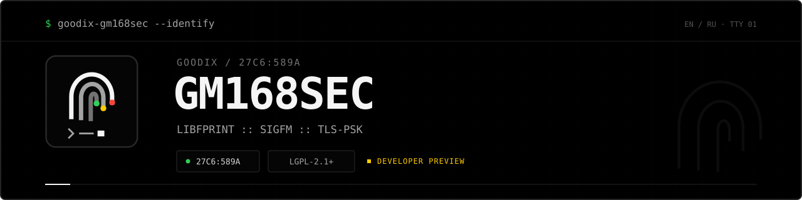

<h1>
  
</h1>

<p><strong>English</strong> · <a href="README.ru.md">Русский</a></p>

<p>Linux driver for the <strong>Goodix GM168SEC</strong> fingerprint reader (<code>27c6:589a</code>).<br>It works through <code>libfprint</code> and <code>fprintd</code>, using OpenSSL 3 and SIGFM.</p>

<p><a href="https://github.com/mrcook1e-ai/goodix-gm168sec/actions/workflows/ci.yml"></a> <a href="https://github.com/mrcook1e-ai/goodix-gm168sec/releases"></a> <a href="LICENSE"></a></p>

<p><a href="docs/README.md"><strong>Documentation</strong></a> · <a href="docs/BRANDING.md">Brand</a> · <a href="CONTRIBUTING.md">Contribute</a></p>

> This is an experimental project. The only confirmed device is `27c6:589a`
> running `GFUSB_GM168SEC_APP_10036`. Keep password authentication enabled.

## Install on Fedora 45 (x86_64)

No build is required:

1. Download **`libfprint-goodix-gm168-0.2.0-...fc45.x86_64.rpm`** from the
   [Releases page](https://github.com/mrcook1e-ai/goodix-gm168sec/releases).
2. Install it:

   ```bash
   sudo dnf install ./libfprint-goodix-gm168-0.2.0-*.fc45.x86_64.rpm
   ```

3. Reconnect the reader if it is external. Then enroll a finger through your
   desktop settings or run:

   ```bash
   fprintd-enroll -f right-thumb
   ```

4. Test verification:

   ```bash
   fprintd-verify -f right-thumb
   ```

The RPM installs the udev rule and configures `fprintd`. If `fprintd` is already
running, the installer restarts it.

### Important notes

- The system `libfprint` is **not replaced**. This driver is installed separately
  under `/opt/libfprint-gm168`, and the override applies only to `fprintd.service`.
- This build contains the **GM168 driver only**. While the package is installed,
  do not use the same `fprintd` instance with other fingerprint reader models.
- Old NBIS templates are incompatible with SIGFM. If a finger was enrolled with
  an older driver, delete its template and enroll again:

  ```bash
  fprintd-delete "$USER"
  fprintd-enroll -f right-thumb
  ```

## PSK and Windows

If `/etc/goodix-gm168/psk.bin` is absent, the driver attempts to read the existing
sensor key and uses it only in memory. A separate Windows setup or manual key
recovery is normally unnecessary.

Re-provisioning the reader under Windows can change its key. If you have your own
`psk.bin`, keep it private. Never upload it to issues or publish it together with
logs, calibration files, or fingerprint images.

Details: [PSK recovery](docs/PSK-RECOVERY.md) and [FAQ](docs/FAQ.md).

## Uninstall

```bash
sudo dnf remove libfprint-goodix-gm168
```

After removal, `fprintd` uses the system `libfprint` again. The package does not
delete files in `/etc/goodix-gm168` or stored fingerprint templates.

## Current status

On one device, after a full template reset, the current build completed a live
smoke test: `right-thumb` enrollment finished all `20/20` stages, and all five
verification sessions matched — four on the first touch and one after a retry.
No TLS or watchdog errors occurred in this short series.

This is a result from **one device and a small number of touches**, not a FAR/FRR
measurement or a guarantee for other readers. Other firmware versions,
suspend/resume, and broad compatibility remain unvalidated.

## Source builds and technical details

Fedora users only need the RPM above. To inspect the implementation or contribute:

- [INSTALL.md](INSTALL.md) — dependencies, source builds, and local RPM builds;
- [docs/README.md](docs/README.md) — the complete technical documentation hub;
- [Architecture](docs/ARCHITECTURE.md) and [state machines](docs/STATE-MACHINES.md);
- [USB/TLS protocol](docs/PROTOCOL.md);
- [Image pipeline](docs/IMAGE-PIPELINE.md);
- [SIGFM matching](docs/SIGFM.md);
- [Testing](docs/TESTING.md) and [development](docs/DEVELOPMENT.md).

Contribution rules: [CONTRIBUTING.md](CONTRIBUTING.md). Bug reports:
[Issues](https://github.com/mrcook1e-ai/goodix-gm168sec/issues). Do not attach
keys, templates, calibration files, fingerprint images, or USB captures.

## Credits

Thanks to everyone whose research, code, and testing made this project possible:

| Contributor / project | Contribution |
|---|---|
| **Oleg ([@mrcook1e-ai](https://github.com/mrcook1e-ai))** | Original GM168 research, USB protocol structures, TLS-PSK transport, async SSM state machines, and image pipeline. [`goodix-gm168`](https://github.com/mrcook1e-ai/goodix-gm168) |
| **Daniil Yakoshinov ([@yakoshiq](https://github.com/yakoshiq))** | Hardware validation, security/lifecycle hardening, clean overlay restructuring, and packaging. [`libfprint-goodix-gm168`](https://github.com/yakoshiq/libfprint-goodix-gm168) |
| **wseng ([@wseng](https://github.com/wseng))** | Early driver implementation and protocol contributions. |
| **Space-Dev0 ([@Space-Dev0](https://github.com/Space-Dev0))** | Goodix `27c6:581a` driver, reciprocal matching logic, tiled capture-coverage gate, and deferred deactivation. [`goodix-fingerprint-drivers`](https://github.com/Space-Dev0/goodix-fingerprint-drivers) |
| **Alexander Meiler ([@TheWeirdDev](https://github.com/TheWeirdDev))**, **Matthieu Charette ([@mpi3d](https://github.com/mpi3d))**, **Alireza S.N. ([@alirezasn80](https://github.com/alirezasn80))** | Foundational Goodix `55b4` TLS transport and protocol reverse engineering. [`libfprint (55b4-exp)`](https://github.com/TheWeirdDev/libfprint) |
| **Matthieu Charette ([@mpi3d](https://github.com/mpi3d))**, **Natasha England-Elbro ([@ashenglandelbro](https://gitlab.freedesktop.org/ashenglandelbro))**, **Timur Mangliev ([@tigrmango](https://github.com/tigrmango))** | Original SIGFM algorithm for small capacitive sensors. [libfprint MR !530](https://gitlab.freedesktop.org/libfprint/libfprint/-/merge_requests/530) |
| **libfprint upstream** | Core fingerprint daemon and library infrastructure. [`libfprint`](https://gitlab.freedesktop.org/libfprint/libfprint) |

Substantial portions of the research, code, tests, and documentation were produced
with AI coding assistance under human review and direction. No independent
security audit has been performed. See [NOTICE](NOTICE) for complete attribution.

## License

[LGPL-2.1-or-later](LICENSE), without warranty. See also [NOTICE](NOTICE) and
[SECURITY.md](SECURITY.md).
