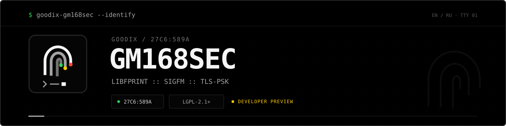

<h1>
  
</h1>

<p>
  <a href="README.md">English</a> · <strong>Русский</strong>
</p>

<p>
  Экспериментальный драйвер <a href="https://gitlab.freedesktop.org/libfprint/libfprint">libfprint</a>
  для ёмкостного сканера отпечатков пальцев <strong>Goodix GM168SEC</strong><br>
  с сопоставлением SIGFM и восстановлением существующего PSK только в памяти без записи.
</p>

<p><a href="https://github.com/mrcook1e-ai/goodix-gm168sec/actions/workflows/ci.yml"></a> <a href="LICENSE"></a> <a href="patches/libfprint-v1.94.100-integration.patch"></a> <a href="INSTALL.md"></a> <a href="#статус"></a></p>

<p>
  <a href="docs/ru/README.md"><strong>Документация</strong></a> ·
  <a href="#быстрый-старт-изолированная-сборка-и-тесты">Сборка и тесты</a> ·
  <a href="docs/ru/BRANDING.md">Айдентика</a> ·
  <a href="CONTRIBUTING.md">Участие в проекте</a> ·
  <a href="https://deepwiki.com/mrcook1e-ai/goodix-gm168sec">DeepWiki</a>
</p>

## Статус

**Предварительная версия для разработчиков от сообщества — не готова к промышленному использованию и включению в upstream.**

- **Подтвержденное оборудование и прошивка**: USB `27c6:589a` с прошивкой
  `GFUSB_GM168SEC_APP_10036` (единственная подтвержденная на данный момент ревизия прошивки).
- **Протестированная платформа**: Fedora 45 с OpenSSL 3 (`openssl3-devel` /
  `openssl >= 3.0, < 4.0`).
- **Конвейер сопоставления**: `FPI_PRINT_SIGFM` (OpenCV SIFT + взаимное сопоставление +
  аффинная проверка RANSAC) вместо NBIS, использующий 20 этапов регистрации с
  фильтрацией дубликатов, пороговый контроль качества по ключевым точкам и покрытию,
  отложенное освобождение ресурсов, ограниченный автоповтор проверки и билинейное
  масштабирование 2x до `160x128`.
- **Фон и калибровка**: динамический захват темного фона по 5 кадрам и его
  вычитание работают «из коробки» без файлов калибровки для конкретного устройства.
  Дополнительные файлы калибровки Windows для конкретного устройства (`calib_windows.dat`,
  `cal_scale.bin`) поддерживаются при локальном размещении, но никогда не требуются
  обязательно и не распространяются.
- **Ограничения**: оценка частоты ложного допуска и ложного отказа проводилась
  только на ограниченном оборудовании и небольшой выборке. Совместимость между
  разными устройствами, другие ревизии прошивки, горячее подключение и жизненный
  цикл сна/пробуждения (suspend/resume) широко не проверялись и не должны считаться
  готовыми к промышленному применению. Всегда оставляйте настроенным резервный
  вход по паролю. Последние изменения взаимного сопоставления, фильтра качества и
  жизненного цикла имеют только подтверждение автономными синтетическими тестами;
  более ранние результаты на реальном оборудовании не подтверждают данную ревизию.

## Разработка с помощью ИИ и уведомление «как есть»

Значительная часть обратного проектирования, реализации, тестирования и документации
в этом проекте была выполнена с помощью ИИ-инструментов программирования под контролем
и руководством человека. Код проверялся на ограниченном тестовом оборудовании и не
проходил независимый аудит безопасности или корректности.

Этот проект предоставляется **«как есть», без каких-либо гарантий** на условиях
GNU Lesser General Public License v2.1 или более поздней версии. См. [`LICENSE`](LICENSE)
и [`NOTICE`](NOTICE).

## Структура репозитория

- `driver/` — исходный код на C и заголовочные файлы драйвера `goodix_gm168` для libfprint
- `patches/` — патч интеграции для зафиксированной версии libfprint `v1.94.100`
  (ядро SIGFM, тесты, политика сборки OpenSSL 3 и исправление белого списка udev/hwdb)
- `tools/apply-overlay.sh` — проверяет чистоту зафиксированной копии `libfprint v1.94.100`,
  копирует драйвер и синтетический тест восстановления и применяет патч
- `tests/` — тесты контракта таймаутов и синтетические тесты восстановления DPAPI/TLV/OpenSSL
- `packaging/` — правило udev `uaccess` и экспериментальный RPM spec для Fedora
- `assets/brand/` — локальные SVG-изображения Secure Signal и social preview для GitHub
- `docs/` — курируемые руководства по архитектуре, протоколу, обратному проектированию,
  SIGFM, восстановлению и тестированию

В репозиторий не включены проприетарные бинарные файлы, образы прошивок, файлы
драйверов Windows, индивидуальные PSK устройств, таблицы калибровки, биометрические
образцы и дампы сетевого/USB-трафика.

## Быстрый старт (изолированная сборка и тесты)

Полные предварительные требования и подробности см. в [`INSTALL.md`](INSTALL.md).

```bash
git clone --branch v1.94.100 --depth 1 \
  https://gitlab.freedesktop.org/libfprint/libfprint.git

./tools/apply-overlay.sh ./libfprint

meson setup build ./libfprint \
  --prefix="$PWD/prefix" \
  -Ddrivers=goodix_gm168 \
  -Dgtk-examples=false \
  -Ddoc=false \
  -Dinstalled-tests=false

meson compile -C build
meson test -C build --print-errorlogs
```

`tools/apply-overlay.sh` отклоняет нечистую копию или копию с любым коммитом,
отличным от `80a4b5ec612892c5c056c48dddaa561452cf37ec` (`v1.94.100`).

## Загрузка PSK и восстановление только в памяти без записи

Сканер принудительно требует рукопожатия TLS 1.2 PSK (`PSK-AES128-CBC-SHA256`) с
использованием **уникального для устройства** 32-байтового ключа, записанного в датчик.

- Если файл `psk.bin` существует, драйвер считывает его из `/etc/goodix-gm168/psk.bin`
  или `$GOODIX_GM168_DIR/psk.bin` и сверяет его SHA-256 с датчиком перед запуском
  TLS. Храните файл с правами `0600` в закрытом каталоге с правами `0700`.
- Если файл отсутствует, драйвер выполняет ограниченное восстановление существующего
  PSK только в памяти без записи: считывает свежий хеш с датчика, динамически
  определяет длину записи DPAPI v1, расшифровывает смежную white-box запись и
  проверяет восстановленный ключ по этому свежему хешу перед запуском TLS. На данный
  момент этот путь подтвержден только для `GFUSB_GM168SEC_APP_10036`.
- При восстановлении ключ используется **только в памяти**. Драйвер не записывает
  `psk.bin` или `sealed.bin`, не записывает новый ключ в датчик, не выполняет ротацию
  ключа датчика и не повторяет попытку после некорректного ответа, несовпадения хеша
  или ошибки TLS.
- Если существующий файл `psk.bin` нечитаем, поврежден или не совпадает с хешем,
  активация завершается ошибкой; файл не игнорируется и не перезаписывается
  автоматически. Переместите заведомо устаревший файл вручную, если хотите повторить
  восстановление с датчика.
- Повторная инициализация сканера в Windows может изменить PSK устройства. Надежно
  сохраните резервную копию собственного `psk.bin` и **никогда** не отправляйте в
  коммиты и не прикладывайте к публичным issue ключи PSK, хеши, данные DPAPI или
  файлы калибровки.

## Краткий обзор архитектуры

```text
  +-----------------------------------------------------------------+
  |                  libfprint Core (FpiPrint / FpiSsm)             |
  +-----------------------------------------------------------------+
             |                                             ^
             | (Async USB I/O & Handshake)                 | (Match / Score)
             v                                             |
  +----------------------------------+             +----------------+
  |       goodix_gm168 Driver        |             | FPI_PRINT_SIGFM|
  |  - Async USB & FpiSsm sequences  |             | - SIFT detector|
  |  - TLS 1.2 PSK Server (OpenSSL 3)|             | - RANSAC affine|
  |  - In-memory read-only recovery  |             | - 20-stage SGFM|
  +----------------------------------+             +----------------+
             |                                             ^
             v (Packed 12-bit sensor frames)               | (160x128 frame)
  +-----------------------------------------------------------------+
  |  Image Pipeline: 80x64 unpack -> Dynamic dark bg subtraction    |
  +-----------------------------------------------------------------+
```

## Библиотека документации: знакомство с датчиком слой за слоем

Начните с **[центра документации](docs/ru/README.md)** или перейдите к
**[руководству в DeepWiki](https://deepwiki.com/mrcook1e-ai/goodix-gm168sec)**.
Библиотека организована как последовательный маршрут изучения, а не набор
разрозненных заметок.

| Шаг | Материал | Что вы узнаете |
|---:|---|---|
| 1 | [**Обратное проектирование**](docs/REVERSE-ENGINEERING.md) | Как Binary Ninja, динамический анализ, поведение USB и синтетические дифференциальные тесты позволили установить протокол без распространения проприетарных артефактов. |
| 2 | [**Архитектура**](docs/ARCHITECTURE.md) · [**Конечные автоматы**](docs/STATE-MACHINES.md) | Как взаимодействуют асинхронный USB, `FpiSsm`, поток OpenSSL, отмена операций, дедлайны и быстрый путь TLS. |
| 3 | [**Протокол USB и TLS**](docs/PROTOCOL.md) | Что переносят кадры `A0`/`B0`/`B2`, как работают флаги ACK и почему хост запускает сервер legacy TLS-PSK. |
| 4 | [**Конвейер обработки изображений**](docs/IMAGE-PIPELINE.md) | Как упакованные 12-битные строки датчика становятся кадром `80x64`, а затем откалиброванным изображением `160x128` с вычитанием фона. |
| 5 | [**Сопоставление SIGFM**](docs/SIGFM.md) | Почему SIFT + RANSAC заменили NBIS, как `SGFM v1` интегрируется с libfprint и что делают 20 этапов регистрации. |
| 6 | [**Восстановление PSK**](docs/PSK-RECOVERY.md) | Как динамический разбор DPAPI, white-box расшифрование и проверка по свежему хешу обеспечивают восстановление существующего PSK только в памяти без записи. |
| 7 | [**Тестирование**](docs/TESTING.md) · [**Разработка**](docs/DEVELOPMENT.md) | Как воспроизвести автономные проверки, запустить контроль памяти, сопровождать оверлей и подготовить безопасную проверку на оборудовании. |

Для участия в разработке с помощью ИИ прочитайте [`AGENTS.md`](AGENTS.md); правила
безопасных данных для отчетов об ошибках и участия в проекте приведены в
[`CONTRIBUTING.md`](CONTRIBUTING.md). Частые вопросы по настройке и dual-boot
рассмотрены в [`FAQ`](docs/FAQ.md).

### Практическая лаборатория — палец и секретные данные не требуются

После описанной выше изолированной сборки запустите синтетические наборы тестов
восстановления и сопоставления:

```bash
meson test -C build \
  goodix-gm168-psk-recovery fpi-sigfm sigfm-tests goodix-gm168-frame-layout \
  --print-errorlogs
```

Эти тесты проверяют зафиксированные криптографические векторы, некорректные входные
данные DPAPI/TLV, сериализацию/сопоставление/взаимную фильтрацию и проверку качества
SIGFM, разметку упакованных кадров и негативные контрольные случаи без обращения
к датчику. Описание Valgrind и границы между подтверждением автономными
синтетическими тестами и подтверждением на реальном оборудовании см. в
[`docs/TESTING.md`](docs/TESTING.md).

## Благодарности и происхождение кода

Этот проект опирается на фундаментальные исследования, драйверы и алгоритмы,
созданные сообществом Linux-биометрии:

| Участник / проект | Роль и ключевой вклад | Ссылки и репозитории |
|---|---|---|
| **Oleg ([@mrcook1e-ai](https://github.com/mrcook1e-ai))** | Первоначальное исследование GM168, структуры протокола USB, транспорт TLS-PSK, асинхронные конечные автоматы SSM, конвейер обработки изображений | [`mrcook1e-ai/goodix-gm168`](https://github.com/mrcook1e-ai/goodix-gm168) |
| **Daniil Yakoshinov ([@yakoshiq](https://github.com/yakoshiq))** | Проверка на оборудовании, усиление безопасности и жизненного цикла, реструктуризация чистого оверлея и пакетирование | [`yakoshiq/libfprint-goodix-gm168`](https://github.com/yakoshiq/libfprint-goodix-gm168) |
| **wseng ([@wseng](https://github.com/wseng))** | Ранняя реализация драйвера и вклад в исследование протокола | [`github.com/wseng`](https://github.com/wseng) |
| **Space-Dev0 ([@Space-Dev0](https://github.com/Space-Dev0))** | Драйвер Goodix `27c6:581a`, логика взаимного сопоставления, пороговая проверка покрытия по фрагментам, отложенная деактивация | [`goodix-fingerprint-drivers`](https://github.com/Space-Dev0/goodix-fingerprint-drivers) |
| **Alexander Meiler ([@TheWeirdDev](https://github.com/TheWeirdDev))**, **Matthieu Charette ([@mpi3d](https://github.com/mpi3d))**, **Alireza S.N. ([@alirezasn80](https://github.com/alirezasn80))** | Основополагающий транспорт TLS и обратное проектирование протокола Goodix 55b4 | [`TheWeirdDev/libfprint (55b4-exp)`](https://github.com/TheWeirdDev/libfprint) |
| **Matthieu Charette ([@mpi3d](https://github.com/mpi3d))**, **Natasha England-Elbro ([@ashenglandelbro](https://gitlab.freedesktop.org/ashenglandelbro))**, **Timur Mangliev ([@tigrmango](https://github.com/tigrmango))** | Оригинальный алгоритм SIGFM (Scale-Invariant Geometric Feature Matching) для малых емкостных датчиков | [libfprint MR !530](https://gitlab.freedesktop.org/libfprint/libfprint/-/merge_requests/530) |
| **libfprint upstream** | Базовая инфраструктура демона и библиотеки для работы с отпечатками пальцев | [`gitlab.freedesktop.org/libfprint/libfprint`](https://gitlab.freedesktop.org/libfprint/libfprint) |

## Лицензия

Распространяется под лицензией **LGPL-2.1-or-later**. Полные юридические условия,
уведомления об авторских правах и сведения о clean-room происхождении кода см. в
[`LICENSE`](LICENSE) и [`NOTICE`](NOTICE).
