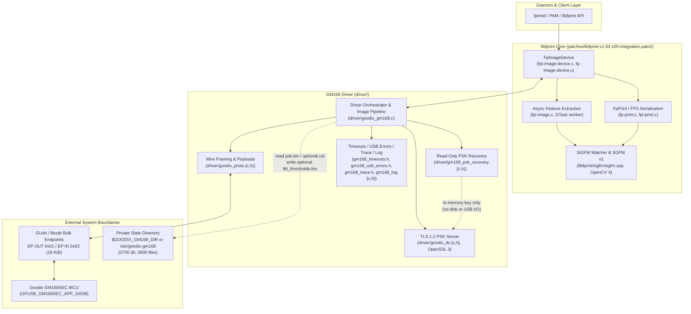
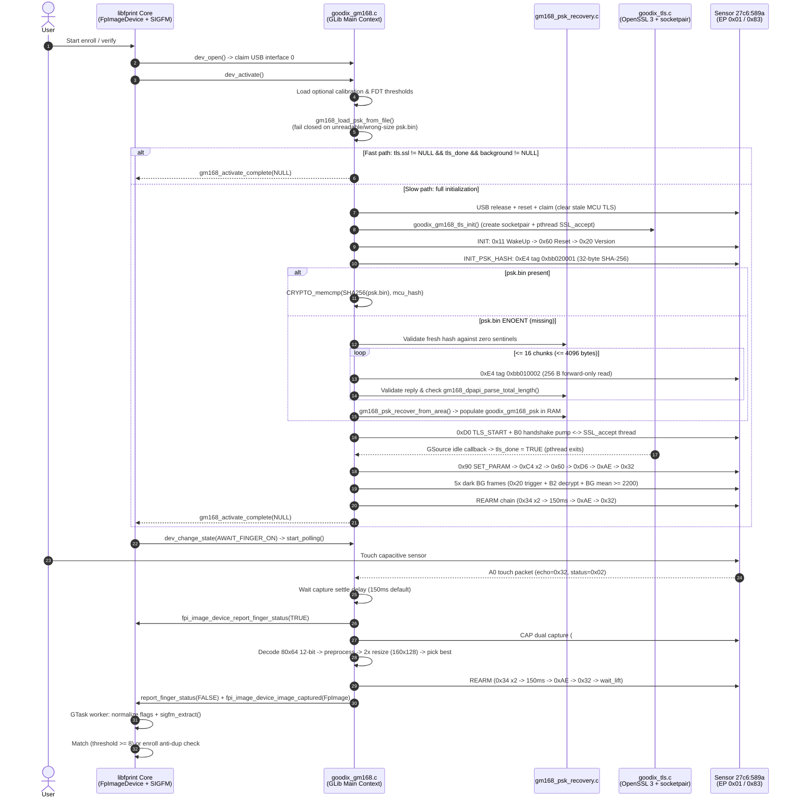

# Architecture Overview

The `goodix_gm168` overlay extends `libfprint v1.94.100` (`80a4b5ec612892c5c056c48dddaa561452cf37ec`) with an asynchronous driver for the Goodix GM168SEC capacitive fingerprint sensor (`27c6:589a`) and a core `FPI_PRINT_SIGFM` matching pipeline.

## Component Map

### Module Responsibilities

| Component | Source Files | Responsibility | External Dependencies |
|---|---|---|---|
| **Driver Core** | `driver/goodix_gm168.c` | `FpImageDevice` lifecycle, `INIT`/`CAP`/`REARM`/`RECOVER`/`DEINIT` SSMs, polling, frame decoding, preprocessing, quality gate, dual capture, state file loading | GLib, `GUsb`, `FpiSsm`, OpenSSL `OPENSSL_cleanse`/`CRYPTO_memcmp` |
| **Protocol Codec** | `driver/goodix_proto.c`, `driver/goodix_proto.h` | `0xA0`/`0xB0`/`0xB2` packet encode/decode, header & body checksums, touch packet matcher, static Windows-captured register/FDT payloads, runtime `goodix_gm168_psk[32]` buffer | GLib |
| **TLS Adapter** | `driver/goodix_tls.c`, `driver/goodix_tls.h` | OpenSSL 3 TLS 1.2 server (`PSK-AES128-CBC-SHA256`), `AF_UNIX` `socketpair` bridge, handshake thread, `GMainContext` completion source | OpenSSL 3 (`>= 3.0, < 4.0`), POSIX sockets, `pthread` |
| **PSK Recovery** | `driver/gm168_psk_recovery.c`, `driver/gm168_psk_recovery.h` | Pure buffer-only DPAPI v1 total-length parser, `0xbb010003` TLV validator, `SecWhiteEncrypt` root/IV/AES-128-CBC/HMAC-SHA256 decrypt, `0xE4` reply validators | OpenSSL 3 (`EVP`, `HMAC`, `CRYPTO_memcmp`, `OPENSSL_cleanse`), GLib |
| **Support Headers** | `driver/gm168_timeouts.h`, `driver/gm168_usb_errors.h`, `driver/gm168_trace.h`, `driver/gm168_log.{c,h}` | Compile-time-asserted timing/deadline constants, USB error classification, opt-in `[TRACE]` measurements, opt-in `$GM168_LOG_DIR` session text logs | GLib, `GUsb` |
| **SIGFM Subsystem** | `patches/libfprint-v1.94.100-integration.patch` (`libfprint/sigfm/*`, `fpi-image.c`, `fpi-print.c`, `fp-print.c`, `fpi-image-device.c`) | SIFT keypoint extraction, Lowe ratio + RANSAC partial-affine verification, `SGFM` v1 serialization, `FP3` integration, enroll anti-dup, verify auto-retry | OpenCV 4 (`core`, `features2d`, `calib3d`), GLib `GTask` |

## Activation-to-Verify Data Flow

## Threading and GLib Owner Context

The driver preserves strict thread confinement around `libfprint`'s single-threaded GLib main-loop model:

1. **GLib Owner Context (Driver & SSM Loop)**:
   - Every `FpiSsm` run-state handler, `FpiUsbTransfer` callback, timer callback (`fpi_device_add_timeout`), and `FpImageDevice` transition executes on the thread-default `GMainContext` captured during `goodix_gm168_tls_init()`.
   - Because all post-handshake USB RX/TX and TLS decryption (`goodix_gm168_tls_feed`, `goodix_gm168_tls_recv`, `goodix_gm168_tls_send`) run exclusively on this owner context after the handshake thread exits, `SSL_read` and `SSL_write` require no locks.
   - Outgoing USB bytes queued for OpenSSL are buffered in `self->feed_pending` (`GByteArray` + `feed_offset`) and drained non-blockingly by `flush_feed_pending()` so the owner main loop never blocks on socket capacity.

2. **OpenSSL Handshake Worker (`pthread`) + `AF_UNIX` `socketpair`**:
   - OpenSSL `SSL_accept()` is synchronous and blocking. To keep `libfprint` event dispatch responsive, `goodix_tls.c` creates a bidirectional `AF_UNIX` `SOCK_STREAM` `socketpair`:
     - `sock_fd` is bound to `SSL *` and owned by `tls_serve_thread` during `SSL_accept()`.
     - `client_fd` is `O_NONBLOCK` and owned by the GLib main loop (`goodix_gm168_tls_feed()` writes MCU handshake bytes; `goodix_gm168_tls_pull()` reads OpenSSL response flights without blocking).
   - Opposite ends of a POSIX `socketpair` allow concurrent kernel-buffered read/write without a data mutex.
   - `SO_RCVTIMEO` (`15 s`) bounds `SSL_accept()` against stalled handshakes and covers the 10 s INIT watchdog plus pre-TLS recovery. `goodix_gm168_tls_deinit()` requests cancellation, shuts down the socket, and joins the worker on the `init_completed()` error path, slow-path `dev_activate()`, and object finalization. Normal `dev_deactivate()` deliberately preserves a working TLS session for the fast path.
   - Handshake completion is **never** invoked from `tls_serve_thread`: the worker attaches a `GSource` (`g_idle_source_new()`) to `self->owner_context`, guarded by `state_lock` (`completion_queued` / `completion_delivered` / `cancel_requested`), so `on_tls_done()` runs safely on the owner context.

3. **SIGFM Worker (`GTask`)**:
   - Feature extraction (`fpi_image_extract_sigfm_info()` in `libfprint/fpi-image.c`) validates dimensions and uses an atomic CAS on `self->detection_in_progress` before launching `fpi_image_extract_sigfm_thread_func()` via `g_task_run_in_thread()`.
   - Image normalization (`H_FLIPPED`, `V_FLIPPED`, `COLORS_INVERTED`) and OpenCV `cv::SIFT::detectAndCompute()` execute on the GLib thread pool and marshal `SigfmImgInfo` back on completion.

## Asynchronous USB Transfer Model

- **Endpoints & Buffers**:
  - `GOODIX_GM168_EP_OUT` (`0x01`): command (`0xA0`) and TLS (`0xB0`) transfers submitted asynchronously via `fpi_usb_transfer_submit()` with `GM168_USB_TX_TIMEOUT_MS` (`2000 ms`).
  - `GOODIX_GM168_EP_IN` (`0x83`): `16 KiB` (`GOODIX_GM168_EP_IN_SIZE`) bulk reads—large enough for a full `10564`-byte `B2` frame plus framing overhead. Short transfers are valid (`short_is_error = FALSE`) during polling and image stitching.
- **Reassembly & Framing**:
  - `self->stitch_buf` accumulates raw `EP_IN` chunks across short USB reads; `CAP_PROCESS` and `INIT_BG_PROCESS` parse `A0`/`B0`/`B2` packets from the buffer head, feeding decrypted TLS payloads into `self->img_buf`.
- **Shared Cancellation & Error Taxonomy**:
  - A single `self->io_cancellable` (`GCancellable`) is created per `dev_activate()`, connected to `libfprint`'s `action_cancellable`, and cancelled in `dev_deactivate()` to abort in-flight USB transfers in milliseconds.
  - `gm168_classify_usb_error()` (`driver/gm168_usb_errors.h`) maps USB failures into `CANCELLED`, `TIMEOUT`, `NO_DEVICE`, `IO`, and `OTHER`; `NO_DEVICE` marks `self->device_dead = TRUE` and propagates `FP_DEVICE_ERROR_REMOVED`.

## Private State Directory & Persistence Boundary

Runtime files are resolved from `$GOODIX_GM168_DIR` if set, or `/etc/goodix-gm168` by default:

| File | Mode / Owner | Access Pattern | Purpose |
|---|---|---|---|
| Directory (`$GOODIX_GM168_DIR` or `/etc/goodix-gm168`) | `0700`, UID-matched, non-symlink | Read / optional FDT write | Checked via `g_lstat()` in `gm168_ensure_private_dir()` |
| `psk.bin` | `0600` (`root:root` for `fprintd`) | **Read-only** by driver | Optional 32-byte per-device PSK backup; never written or overwritten by the driver |
| `fdt_thresholds.bin` | `0600` | Read + optional write | Optional 6-byte per-device capacitive FDT baseline captured from `0x34` baseline replies |
| `calib_windows.dat` | `0600` | **Read-only** (optional) | Optional `140464`-byte per-device Windows calibration block |
| `cal_scale.bin` | `0600` | **Read-only** (optional) | Optional `10240`-byte per-device gain plane |

### Key Separation Guarantees

- **Recovery module isolation**: `driver/gm168_psk_recovery.c` is pure in-memory C with **zero** USB calls and **zero** filesystem I/O. It operates strictly on caller-supplied buffers and cleanses temporary and error buffers with `OPENSSL_cleanse()`.
- **No automatic PSK persistence**: when `psk.bin` is absent (`ENOENT`), recovered PSK material is stored only in `goodix_gm168_psk[32]` in RAM. It is cleared before loading on slow-path `dev_activate()`, immediately after `SSL_accept()` returns in `on_tls_done()`, on the `init_completed()` error path after TLS deinit, and at object finalization. The transient E4 area is additionally cleared on `dev_deactivate()`. `fprintd` requires no `ReadWritePaths` exception for PSK recovery under systemd sandboxing (`ProtectSystem`) or SELinux.
- **Fail-closed host key policy**: an unreadable, non-32-byte, or hash-mismatching `psk.bin` aborts activation rather than falling back to recovery or silently replacing the file.
