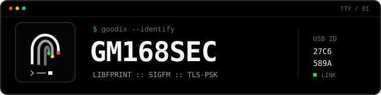

  

**English** · [Русский](ru/BRANDING.md) · [Project](../README.md) · [Documentation](README.md)

# Secure Signal — Brand & Documentation System

Secure Signal is the shared visual and editorial language of `goodix-gm168sec`.
It presents the project as precise open engineering: experimental where evidence
is limited, explicit about security boundaries, and readable in English and Russian.
Its **OLED CLI** visual system uses true black, white monospace type, quiet gray
structure, and sparse traffic-light accents.

## 1. Brand Principles

- **Precise** — technical identifiers, versions, and limitations stay visible.
- **Open** — native Markdown, local assets, and no tracking or external artwork.
- **Security-conscious** — recovery and safety language must remain exact.
- **Honest** — never turn synthetic or limited-hardware results into broad claims.
- **Bilingual** — both languages belong to one project, not two separate brands.
- **Monochrome first** — color communicates a small state or signal, never decoration.

## 2. The Mark

Three monochrome synthetic sensor paths move through a capacitive field and
terminate in tiny red, amber, and green protocol nodes. The open paths represent
inspectable engineering; the nodes represent USB, TLS-PSK, and matching signals.
The geometry is drawn entirely from primitives and does not contain or reproduce
a real fingerprint. A small prompt and block cursor reinforce the CLI language.

The wordmark is **`GM168SEC`**. `GOODIX` identifies the sensor family;
`LIBFPRINT :: SIGFM :: TLS-PSK` is the stable technical descriptor. Do not replace
`GM168SEC` with a translated name.

## 3. Asset Inventory

All artwork is local and self-contained. SVG files have no scripts, remote fonts,
external images, or network dependencies.

| Asset | Purpose |
|---|---|
| [`assets/brand/mark.svg`](../assets/brand/mark.svg) | Compact square mark for documentation and small brand references |
| [`assets/brand/logo.svg`](../assets/brand/logo.svg) | Horizontal lockup for guides, presentations, and wide placements |
| [`assets/brand/header.svg`](../assets/brand/header.svg) | Language-neutral header used by both root README versions |
| [`assets/brand/social-preview.svg`](../assets/brand/social-preview.svg) | Editable social-preview master |
| [`assets/brand/social-preview.png`](../assets/brand/social-preview.png) | Rendered 1280×640 image for GitHub repository settings |

Use SVG for documentation and PNG only where a raster image is required. Keep
the existing view boxes and aspect ratios.

## 4. Spacing and Reproduction

- Keep clear space around the mark equal to at least one quarter of its width.
- Use the standalone mark at **32 px or larger** and the horizontal logo at
  **280 px or larger**.
- Retain the supplied pure-black OLED background; it is part of the logo construction.
- Do not rotate, crop, outline, recolor, add gradients, glows, shadows, or rearrange logo elements.
- Do not place the mark over real fingerprint images, packet captures, or busy
  photographic backgrounds.
- Do not imply Goodix endorsement, upstream acceptance, production readiness, or
  a security audit through branding.

## 5. Color System

| Token | Hex | Role |
|---|---|---|
| **OLED Black** | `#000000` | Primary background |
| **Terminal Black** | `#050505` | Mark and control surfaces |
| **Grid Gray** | `#2A2A2A` | Borders, separators, and quiet structure |
| **Muted Gray** | `#737373` | Tertiary labels and inactive metadata |
| **CLI Gray** | `#A3A3A3` | Secondary text and secondary sensor paths |
| **Signal White** | `#F5F5F5` | Wordmark, primary text, and primary paths |
| **Stop Red** | `#FF453A` | One tiny protocol node or a critical state |
| **Wait Amber** | `#FFCC00` | Developer-preview and caution states only |
| **Go Green** | `#30D158` | One tiny protocol node, prompt, or active status |

Use color as a sparse signal: no gradients, glows, cyan fills, or multicolor body
text. Most of every composition must remain black, white, and gray. GitHub body
text, links, and code use the platform's native accessible colors. Red, amber,
and green must remain small enough that the monochrome structure dominates.

## 6. Typography

- **Display / wordmark:** JetBrains Mono, with DejaVu Sans Mono and monospace
  fallbacks. Weight 600; compact spacing is allowed only at display sizes.
- **CLI labels / metadata:** the same monospace stack at regular weight. Use for
  prompts, USB IDs, protocol labels, versions, and short status fields.
- **GitHub prose:** the platform's native sans-serif and monospace fonts. Do not
  imitate typography with images for ordinary documentation text.

Keep identifiers such as `27c6:589a`, `FPI_PRINT_SIGFM`, `psk.bin`, and command
examples in inline code or fenced blocks.

## 7. README Composition

The root entry page follows one consistent order:

1. Local `header.svg` hero;
2. reciprocal **English / Русский** switch;
3. one-sentence project description;
4. at most five high-value badges: CI, license, pinned libfprint, OpenSSL, status;
5. primary navigation;
6. status and limitations before build instructions.

Use GitHub's default left alignment for the hero, language switch, badges,
navigation, and headings. Do not center these elements: a shared left edge keeps
the LTR reading order clear and makes long documentation easier to scan.

Avoid external typing animations, duplicate taglines, decorative badge rows, and
HTML layouts for long-form prose. Use native Markdown headings, tables, lists,
and code blocks so that mobile rendering and accessibility remain predictable.

## 8. Bilingual Information Architecture

- **English is the canonical technical source** at existing paths. This preserves
  established links and the upstream contribution workflow.
- **Russian entry pages mirror the source:** `README.ru.md`, `docs/ru/README.md`,
  and `docs/ru/BRANDING.md`.
- Place a reciprocal language switch at the top of every translated page.
- Use one language per page. Do not alternate complete English and Russian
  paragraphs in the same document.
- Keep commands, code, identifiers, filenames, and product names unchanged.
- Until a deep technical guide is translated, Russian indexes link explicitly to
  its English source rather than creating a partial or outdated copy.
- Update both entry pages in the same change when status, compatibility,
  limitations, commands, or safety guidance changes.
- Treat translations as reviewable project content, not machine-generated prose
  that can drift without review.

## 9. Core Terminology

| English | Русский |
|---|---|
| developer preview | предварительная версия для разработчиков |
| driver overlay | оверлей драйвера |
| matching | сопоставление |
| enrollment | регистрация |
| verification | проверка |
| read-only in-memory PSK recovery | восстановление существующего PSK только в памяти без записи |
| synthetic fixture | синтетический тестовый набор |
| offline synthetic proof | подтверждение автономными синтетическими тестами |
| live hardware proof | подтверждение на реальном оборудовании |
| clean-room engineering | проектирование по принципу «чистой комнаты» |
| upstream-ready | готовый к включению в upstream |
| password fallback | резервная аутентификация по паролю |

Use **сопоставление** for the matching operation, not **идентификация**, unless
the source specifically describes identification. Preserve **read-only** and
**in-memory** whenever PSK recovery is summarized.

## 10. Voice and Claims

Write directly and define necessary jargon. Prefer “the synthetic suite verifies
this parser” over “secure” or “fully tested.” Always distinguish:

- **offline synthetic proof** from **live hardware proof**;
- confirmed firmware from possible compatibility;
- community development from upstream or vendor support;
- read-only recovery from provisioning or key modification.

Never use real biometric samples, secrets, calibration data, or proprietary
artifacts to make promotional graphics.

## 11. GitHub Social Preview

GitHub does not automatically apply a repository-local social-preview file.
Upload [`assets/brand/social-preview.png`](../assets/brand/social-preview.png)
manually under **Repository → Settings → General → Social preview**. Keep the
SVG as the editable source and regenerate the PNG after approved brand changes.

## 12. Contribution Checklist

Before merging brand or entry-page changes:

- validate every SVG as XML and inspect its rendered output;
- verify light/dark GitHub readability and mobile-width behavior;
- check both language switches and every changed relative link;
- compare status, commands, and warnings between EN and RU;
- keep all artwork free of biometric, secret, and proprietary material;
- run `git diff --check` and review the final diff.
