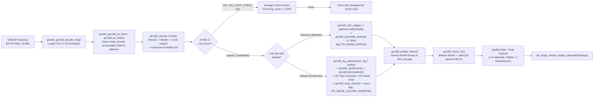

# Image Acquisition and Preprocessing Pipeline

## In Plain English (TL;DR)

When your finger touches the sensor, the hardware does not immediately hand Linux a clean PNG. Instead, the driver runs a short cleanup pipeline so SIFT can see crisp skin ridges:

1. **Take 5 blank "dark" pictures at cold startup** (when no finger is on the glass) to measure the sensor's baseline noise. If a finger is already resting on the pad (`mean < 2200`), the driver rejects the "poisoned" background and waits for you to lift first.
2. **Unpack raw 12-bit USB pixels**: Each decrypted `10564`-byte frame holds `80` padded rows of packed 12-bit sensor readings, transposed into an `80×64` grayscale image.
3. **Subtract background & boost local ridges**: Subtracting the dark baseline, removing single-pixel speckles (`3x3` median), and stretching local contrast brings out pores and ridges cleanly — no Windows calibration files needed.
4. **Pick the sharper of 2 frames (`dual capture`) & upscale `2x`**: Touching once triggers two quick frames back-to-back (capturing the settled finger) and picks the higher-contrast one, then scales `80×64` → `160×128` (`2x`, which outperformed `3x` and `4x` in testing).

The Goodix GM168SEC captures small capacitive frames (`80x64` native pixels) encrypted over TLS `B2` packets and transforms them into `160x128` 8-bit grayscale `FpImage` objects for `libfprint` `FPI_PRINT_SIGFM` extraction.

> **Privacy Notice**
>
> All diagnostic frame-dump features (`GM168_DUMP_FRAMES`) are disabled by default. Never store or publish real captured `.pgm` frames or unredacted metadata from physical touches.

## End-to-End Image Pipeline



## 10564-Byte Wire Frame Format and Unpacking

### `B2` Sub-Header Stripping (`driver/goodix_proto.c`)

`goodix_gm168_decode_img()` scans up to the first `32` bytes of the `B2` inner payload (`[B2][inner_len_L][inner_len_H][hdrsum][sub-header...][TLS]`) for the TLS Application Data record header `0x17 0x03 0x03` (falling back to offset `+13` if absent) and feeds the TLS ciphertext into `goodix_gm168_tls_feed()`.

### `10564`-Byte Plaintext Layout (`gm168_decode_frame`)

Once `self->img_len >= GM168_TLS_FRAME_SIZE` (`10564` bytes):

- **Payload**: first `10560` bytes (`GM168_TLS_PAYLOAD_SIZE`) arranged as `80` wire rows (`GM168_WIRE_ROWS`) × `132` bytes (`GM168_WIRE_ROW_STRIDE`).
  - First `96` bytes (`GM168_WIRE_ROW_DATA`) per row carry packed 12-bit pixel data (`16` groups of `6` bytes = `64` pixels per wire row).
  - Trailing `36` bytes per wire row are zero padding.
- **Trailer**: final `4` bytes (`[10560..10563]`) are a CRC/padding trailer ignored by `gm168_decode_frame()`. Note that pixel data begins directly at plaintext offset `0` (there is no leading 4-byte header inside the TLS plaintext).

#### 12-Bit Unpacking & Transpose

De-padding yields `80 * 96 = 7680` compact bytes (`5120` 12-bit pixels). Each `6`-byte group `b0..b5` unpacks into 4 pixels `P0..P3`:

```text
P0 = ((b0 & 0x0F) << 8) | b1
P1 = (b3 << 4)          | (b0 >> 4)
P2 = ((b5 & 0x0F) << 8) | b2
P3 = (b4 << 4)          | (b5 >> 4)
```

Logical pixel `k` (`0..5119`) is written to `out[(k % 64) * 80 + (k / 64)]`, transposing the `80x64` wire stream inline into a row-major **`64` rows × `80` columns** (`GM168_FRAME_W = 80`, `GM168_FRAME_H = 64`) `guint16` array.

## Dynamic Background Capture and Sanity Gate

When no optional calibration files are loaded, `INIT` captures **`GM168_BG_FRAMES = 5`** dark no-finger frames (`INIT_BG_TRIG` → `INIT_BG_RX` → `INIT_BG_PROCESS`) and averages them pixel-wise into `self->background`:

- `INIT_BG_PROCESS` parses `B0`, `B2`, and `A0` packets using the exact same loop structure as `CAP_PROCESS` so partial reads or control packets cannot cause non-deterministic background averages.
- **Background validation gate**: `INIT_BG_LOOP_CHECK` computes `bg_mean` across all `5120` pixels and compares it against `GM168_BG_MIN_MEAN` (default **`2200`**, overridable `0..4095`).
  - If a finger is resting on the sensor during cold start, `bg_mean` drops below `2200`; accepting that frame would poison background subtraction for the entire session.
  - On rejection, the driver frees `background_sum`, sets `bg_waiting_lift = TRUE`, runs `INIT_BG_REARM_*` + `INIT_BG_WAIT_LIFT`, and retries up to `GM168_BG_RETRIES` (default **`3`**, max `10`) before failing `INIT`.

### Atomic FDT Threshold Loading and Calibration

Saved `fdt_thresholds.bin` data is validated across all six channels before any byte of `self->fdt_setup` is changed. Runtime calibration likewise computes all six thresholds locally and rejects the whole packet if any baseline is zero; it never persists a zero threshold that the next activation would reject. Invalid input therefore leaves the previous complete default/valid setup intact.

## Preprocessing Paths

`gm168_envelope_stretch()` (`driver/goodix_gm168.c`) implements two mutually exclusive paths, followed by `2x` bilinear scaling:

### Path A: Dynamic Background Fallback (Default, No Files Required)

1. **Background subtraction (`gm168_bg_subtract`)**: `out[i] = clamp(raw[i] - bg[i] + 0x800, 0, 0xFFF)` (pass-through if `bg == NULL`).
2. **3×3 median filter (`gm168_median3x3`)**: suppresses hot/flicker pixel outliers while preserving ridge edges.
3. *(Opt-in only, default OFF)* **Wallis local-mean smoother (`gm168_smooth_wallis`, `GM168_USE_WALLIS=1`)**: computes `clamp(input - 11×11 local mean + 3000, 0, 65535)`. The upper clamp prevents wraparound when optional CAL2 output uses the full 16-bit range. **Keep disabled**: removing low-frequency variation degrades downstream envelope contrast and causes matching regressions.
4. **3×3 binomial blur (`gm168_binomial3x3`)**: `(1,2,1; 2,4,2; 1,2,1) / 16` with half-up rounding (`(s + 8) >> 4`).
5. **Horizontal & Vertical 11-pixel envelopes (`gm168_envelope_h`, `gm168_envelope_v`, `gm168_envelope_combine`)**: sliding min/max over `GM168_ENV_WIN = 11` pixels (edge-replicated), combined as `low = min(low_h, low_v)` and `high = max(high_h, high_v)`.
6. **5-point X morphological close (`gm168_morph_close_x5`)**: erodes `high` (min over center + 4 diagonals) and dilates `low` (max over center + 4 diagonals).
7. *(Legacy/opt-in, default OFF)* **Finger-presence mask (`gm168_finger_mask`, `GM168_FINGER_MASK=1`, `GM168_MASK_THRESH=200`)**: `7x7` mean `|raw - bg|` mask; largely unnecessary with SIGFM and barely masks at typical contrast.
8. **Local contrast stretch & inversion (`gm168_local_stretch`)**:
   ```text
   denom = high[i] - low[i]
   out[i] = (denom <= weak_gap) ? 0x80 : 0xFF - clamp((signal[i] - low[i]) * 255 / denom, 0, 255)
   ```
   Output `FpImage` is tagged `FPI_IMAGE_COLORS_INVERTED`; `libfprint` core inverts colors (`0xFF - v`) prior to SIGFM extraction so ridges appear dark on light.

### Path B: Optional Per-Device Windows Calibration

If matching `calib_windows.dat` (`140464` bytes / `0x224b0`) and `cal_scale.bin` (`10240` bytes) are both present in `$GOODIX_GM168_DIR` or `/etc/goodix-gm168` (`0600`), `gm168_load_calibration_from_files()` validates:
- Exact file sizes;
- Non-zero 12-bit (`<= 0x0FFF`) values in Plane A (`0x0004`, dark) and Plane B (`0x9924`, bright), plus non-zero `cal_scale` divisors;
- `bright > dark` on at least `95%` of pixels;
- Zero-filled padding from pixel `5120` to `7040` words in both planes.

When active, `gm168_cal2_stage()` computes:
```text
corrected[i] = clamp(round((cal1[i] - raw[i]) * 8192 / cal2[i]), 0, 0xFFFF)
```
followed by optional `GM168_USE_MEDIAN` / `GM168_USE_WALLIS` and `gm168_percentile_stretch()` (2nd–98th percentile stretch, `0x80` if flat), tagging the resulting `FpImage` with `FPI_IMAGE_PARTIAL`.

## `2x` Bilinear Upscale (`160x128`)

Because the native `80x64` grid is too small for feature detectors, `gm168_resize_2x()` enlarges the `80x64` processed image (`GM168_IMAGE_SCALE = 2`) to **`160x128`** (`GM168_OUTPUT_W` × `GM168_OUTPUT_H`) with `fp_img->ppmm = 19.685f * 2.0f` (`39.37` px/mm). Doing this inside the driver ensures consistent output even if `libfprint` was built without `pixman` (where `fpi_image_resize()` is a no-op).

## Quality Gate and Dual Capture

To avoid submitting smudged landing frames or timing out on held touches, `capture_completed()` pairs a central quality heuristic with dual-frame selection:

1. **Quality metric (`gm168_quality_metric` on `80x64` frame)**:
   - Inspects the central `48x48` crop (`x = 16..63`, `y = 8..55`) where ridges sit and outer illumination falloff is excluded.
   - **Saturation gate**: if `> 30%` of central pixels are saturated (`<= 2` or `>= 253`), immediately returns `0.0f`.
   - Otherwise returns the pixel standard deviation (`sqrt(variance)`).
2. **Quality-gate retry loop**:
   - Retries capture (`start_rearm_retry_ssm()` with `200 ms` delay, skipping `finger_status(FALSE)`) if `best_quality < GM168_QUALITY_THRESH` (`25.0f`) **unless**:
     - `best_quality == 0.0f` (all-saturated/blank touch — submits immediately rather than wasting retries),
     - `capture_attempt >= GM168_MAX_CAPTURE_ATTEMPTS` (`6`), or
     - `elapsed >= GM168_CAPTURE_BUDGET_MS` (`600 ms`).
3. **Dual capture (`dual_in_second`)**:
   - Once the first quality-accepted frame (`dual_pending_img`) is obtained, the driver immediately triggers a **second** `SCAN_TRIG` (`start_capture_ssm()`) **without** an intermediate `REARM` (mirroring observed Windows capture behavior while the finger stays settled).
   - When frame #2 finishes, `capture_completed()` picks whichever of `#1` or `#2` has the higher `quality` score and submits it via `start_rearm_ssm()`.
   - **Error fallback**: if a subsequent retry or dual frame #2 fails with a recoverable capture error while `best_img` or `dual_pending_img` already holds a viable frame, the candidate with the higher quality is submitted and the other is released. `FP_DEVICE_ERROR_REMOVED` and cancellation never use this fallback.

## Diagnostic Frame Dumps (`GM168_DUMP_FRAMES`)

Setting `GM168_DUMP_FRAMES=<dir>` enables per-capture `.pgm` stage snapshots (`raw`, `bg`, `bgsub`, `envgap`, `mask`, `final`) and `-meta.txt` statistics (`quality`, `used_cal`, min/max/mean per stage). Keep this disabled during normal operation and treat any output directory as sensitive biometric data.
