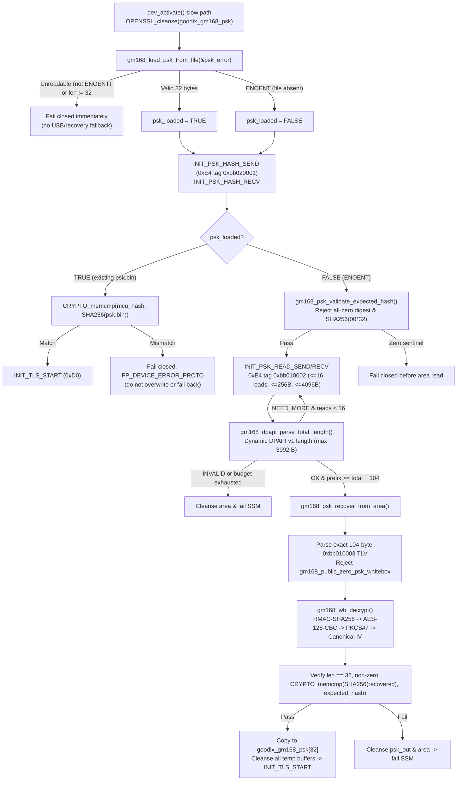

# Read-Only PSK Recovery

The Goodix GM168SEC sensor enforces a TLS 1.2 PSK handshake using a device-specific 32-byte key stored inside the MCU. When `<dir>/psk.bin` (`$GOODIX_GM168_DIR` or `/etc/goodix-gm168`) is absent (`ENOENT`), `driver/goodix_gm168.c` and `driver/gm168_psk_recovery.{c,h}` recover the **existing** sensor key strictly read-only into memory without modifying the MCU, writing `psk.bin`, or calling Windows.

> **Security & Operational Boundaries**
>
> - Recovery **never** sends `0xA4` (erase), `0xE0` (PSK write), `0xF0`/`0xF4` (firmware flash), or USB resets mid-recovery.
> - Recovery **never** writes `psk.bin` or `sealed.bin` to disk; key material lives strictly in RAM for the active `fprintd` / `libfprint` session.
> - Synthetic constants and test vectors live in `driver/gm168_psk_recovery.c` and `tests/test-goodix-gm168-psk-recovery.c`; no real keys, real digests, or real device area bytes are included here.

## Activation Decision Flow: Existing vs. `ENOENT` vs. Malformed/Mismatch



### Policy on Existing vs. Missing `psk.bin`

1. **Existing valid `psk.bin` (`32` bytes)**:
   - Loaded in `dev_activate()`, then verified in `INIT_PSK_HASH_RECV` against the sensor's fresh `0xbb020001` SHA-256 digest via `CRYPTO_memcmp()`.
   - Also primes the MCU keystore after cold boot / deep sleep before `INIT_TLS_START` (`0xD0`).
   - If the sensor rejects the `0xE4` probe with a non-`OK` status while `psk_loaded == TRUE`, the driver logs a warning and continues on the compatibility path to `INIT_TLS_START`. If `0xE4` returns a valid 32-byte digest that **mismatches** `SHA256(psk.bin)`, activation **fails closed** (`FP_DEVICE_ERROR_PROTO`).
2. **Missing `psk.bin` (`ENOENT`)**:
   - The **only** condition that triggers read-only in-memory recovery (`psk_loaded = FALSE`).
   - Any non-`OK` `0xE4` status fails immediately.
3. **Unreadable or malformed `psk.bin` (wrong permissions, I/O error, or `size != 32`)**:
   - **Fails closed inside `dev_activate()`** before USB reset or `INIT` starts. It never falls back to recovery, preventing broken host configuration or corrupted files from being masked silently.

## `0xE4` Wire Format and TLV Tags

All `0xE4` (`GOODIX_GM168_CMD_SPEC_DATA`) commands use a 16-byte little-endian request payload inside an `A0` command frame:

```text
Offset  Size  Field        Value / Purpose
0x00    4     chunk_size   Requested bytes (32 for hash; min(256, 4096 - offset) for area)
0x04    4     offset       Byte offset within area (0 for hash; forward-only end for area)
0x08    4     tag          TLV tag (LE32)
0x0C    4     reserved     0x00000000
```

| Constant (`driver/gm168_psk_recovery.h`) | Tag (LE32) | Role | Expected Reply `extra` Slice (`[tag_echo:4][len:4][data:N]`) |
|---|---|---|---|
| `GM168_PSK_HASH_TLV_TAG` | `0xbb020001` | Fresh SHA-256 of active MCU PSK | Exact `40` bytes (`8` header + `32` digest); validated by `gm168_psk_validate_hash_reply()` |
| `GM168_PSK_AREA_TLV_TAG` | `0xbb010002` | Host-sealed DPAPI v1 blob + trailing white-box record | `8 + chunk` bytes, `1 <= chunk <= requested_len <= 256`, `offset + chunk <= 4096`; validated by `gm168_psk_validate_area_reply()` |
| `GM168_PSK_RECORD_TLV_TAG` | `0xbb010003` | Adjacent white-box TLV inside the `0xbb010002` area | Exact `104` bytes (`tag:4` + `length:4 == 96` + `blob:96`); validated by `gm168_psk_parse_whitebox_record()` |

### Bounded Forward-Only Area Walk

- **Maximum area budget**: `GM168_PSK_MAX_AREA = 4096` bytes, `GM168_PSK_RECORD_LEN = 104` bytes (`8 + 96`), leaving `GM168_PSK_MAX_DPAPI = 3992` bytes maximum for the DPAPI prefix.
- **Chunk budget**: `GM168_PSK_AREA_CHUNK = 256` bytes per read, `GM168_PSK_MAX_AREA_READS = 16` reads maximum (`16 * 256 = 4096`).
- **Forward progress only**: short replies (`1 <= chunk < requested_len`) are accepted only if they strictly advance `self->psk_area_len`; zero-length or over-length replies fail immediately.
- **USB transfer cleansing**: `psk_transfer_cleanse()` calls `OPENSSL_cleanse()` on every `0xE4` bulk RX buffer before returning or re-submitting.

## Dynamic DPAPI v1 Length Parser (`gm168_dpapi_parse_total_length`)

In the `0xbb010002` area, the Windows DPAPI v1 structure sits at offset `0`, and the `104`-byte `0xbb010003` white-box TLV record sits **immediately after** the DPAPI v1 structure at `record_offset = total_len`.

> **Dynamic Offset Rule**
>
> `record_offset` is **always** computed dynamically by parsing the DPAPI v1 field sequence. While `324` bytes has been observed on hardware (and used as one synthetic fixture in `tests/test-goodix-gm168-psk-recovery.c`), `324` is **never** hard-coded—variable description, prompt, salt, signature salt, data, or signature lengths shift the record offset cleanly.

`gm168_dpapi_parse_total_length()` parses the exact DPAPI v1 field order:

1. `dwVersion` (`4 B`, must equal `1`; otherwise `GM168_DPAPI_INVALID`)
2. `guidProvider` (`16 B`)
3. `dwMasterKeyVersion` (`4 B`)
4. `guidMasterKey` (`16 B`)
5. `dwFlags` (`4 B`)
6. `dwDescriptionLen` (`4 B`) + `description` (`dwDescriptionLen` bytes)
7. `dwCryptAlgo` (`4 B`) + `dwCryptAlgoLen` (`4 B` — **bit length only, no payload follows**)
8. `dwSaltLen` (`4 B`) + `salt` (`dwSaltLen` bytes)
9. `dwPromptLen` (`4 B`) + `prompt` (`dwPromptLen` bytes)
10. `dwSignAlgo` (`4 B`) + `dwSignAlgoLen` (`4 B` — **bit length only, no payload follows**)
11. `dwSignSaltLen` (`4 B`) + `signSalt` (`dwSignSaltLen` bytes)
12. `dwDataLen` (`4 B`) + `data` (`dwDataLen` bytes)
13. `dwSignLen` (`4 B`) + `signature` (`dwSignLen` bytes)

### Early Bounds Checking

Every variable byte array in `dpapi_take_bytes()` is checked individually and cumulatively against `GM168_PSK_MAX_DPAPI` (`3992`) **before** checking `reader->offset + length > reader->len`. Impossible sizes therefore return `GM168_DPAPI_INVALID` immediately on the prefix that declared them rather than exhausting all `16` area reads, while legitimate incomplete prefixes return `GM168_DPAPI_NEED_MORE` with no `GError`.

## White-Box Construction (`SecWhiteEncrypt`) and Gates

`driver/gm168_psk_recovery.c` implements the OpenSSL 3 decryption path corresponding to the Windows `SecWhiteEncrypt` container format (using OpenSSL 3 `EVP_*` and `HMAC()` APIs, with no deprecated `HMAC_CTX` calls):

1. **Root Secret Reconstruction (`gm168_wb_derive_root_secret`)**:
   - Reconstructs the fixed 16-byte internal root algorithmically on demand from `"Goodix"` under a 5-step `ror8` rotation schedule (`{1, 3, 5, 7, 9}`), feeding triples into `SHA-256`, four zero-key/zero-IV `AES-{128,192,256}-CBC` block transforms, `HMAC-SHA256`, and `CRC-32/MPEG-2`.
   - The reconstructed root exists only in a stack buffer during `gm168_wb_decrypt()` and is wiped immediately via `OPENSSL_cleanse()`.
2. **Canonical IV & Key Material Derivation**:
   - `D1 = SHA256(LE32(plaintext_len) || "123GOODIX")`
   - `canonical_IV = D1[0..15]`, with the low nibble of byte `15` set to `plaintext_len & 0x0F` (`gm168_wb_derive_iv()`)
   - `key_material (32 B) = SHA256(IV || 48 zero bytes || root[16])`
   - AES-128-CBC key = `key_material[0..15]`; HMAC-SHA256 key = full `key_material[0..31]`.
3. **96-Byte Blob Layout (for 32-byte PSK)**:
   - `[IV: 16 B] || [AES-128-CBC(PKCS#7(PSK)): 48 B] || [HMAC-SHA256(key_material, ciphertext): 32 B]`.
4. **Strict Verification & Decryption Order (`gm168_wb_decrypt`)**:
   - Verify `blob_len >= 64` and `blob_len % 16 == 0`.
   - Verify `HMAC-SHA256` over ciphertext **before** calling AES decrypt (`CRYPTO_memcmp`).
   - Decrypt AES-128-CBC with manual padding disabled, then validate and strip PKCS#7 padding (`1 <= pad <= 16`).
   - Recompute `derived_iv = gm168_wb_derive_iv(plaintext_len)` and verify `CRYPTO_memcmp(iv, derived_iv, 16) == 0` (rejecting non-canonical IVs).
   - Drain OpenSSL errors via `ERR_clear_error()` on every exit path so failed decryptions never poison subsequent TLS calls.
5. **Fresh Hash + Double Zero Gates (`gm168_psk_recover_from_area`)**:
   - **Pre-read hash gate** (`gm168_psk_validate_expected_hash`): rejects an all-zero digest or `SHA256(00 * 32)` before the first `0xbb010002` read.
   - **Record sentinel gate**: rejects `gm168_public_zero_psk_whitebox` (the deterministic 96-byte white-box encoding of `00 * 32`, defined in `driver/gm168_psk_recovery.c` and checked in `tests/test-goodix-gm168-psk-recovery.c`) before attempting decryption.
   - **Post-decrypt shape & hash gates**: rejects `recovered_len != 32`, rejects an all-zero recovered key, and requires `CRYPTO_memcmp(SHA256(recovered), expected_hash, 32) == 0`.

## Failure Matrix

| Scenario | Layer / Error Domain | Driver Outcome | Persistence / Retry |
|---|---|---|---|
| `psk.bin` missing (`ENOENT`) | `gm168_load_psk_from_file()` | Enters read-only recovery in `INIT` | None |
| `psk.bin` unreadable (non-`ENOENT`) or `size != 32` | `G_FILE_ERROR` / `FP_DEVICE_ERROR_GENERAL` | Fail closed in `dev_activate()` | No fallback, no overwrite |
| `psk.bin` present, `0xE4` `0xbb020001` hash mismatch | `FP_DEVICE_ERROR_PROTO` | Fail closed in `INIT_PSK_HASH_RECV` | No overwrite, no recovery |
| `0xE4` hash is all-zero or `SHA256(00*32)` | `GM168_PSK_RECOVERY_ERROR_VERIFY` | Abort before any `0xbb010002` read | No retry |
| `0xE4` reply missing, truncated, wrong tag/len, or no progress | `GM168_PSK_RECOVERY_ERROR_VERIFY` / `FP_DEVICE_ERROR_PROTO` | Max 1 `find_b0_ack` read; else abort | `psk_area` cleansed |
| Non-v1 DPAPI, truncated prefix at `16` reads / `4096 B`, or impossible cumulative length | `GM168_PSK_RECOVERY_ERROR_DPAPI` | Abort recovery & `INIT` SSM | `psk_area` cleansed |
| `0xbb010003` missing, wrong tag/len (`!= 104`), or matches `gm168_public_zero_psk_whitebox` | `GM168_PSK_RECOVERY_ERROR_RECORD` / `_VERIFY` | Abort before decrypt | `psk_out` zeroized |
| White-box HMAC mismatch, bad PKCS#7 padding, or non-canonical IV | `GM168_PSK_RECOVERY_ERROR_WHITEBOX` | Abort; OpenSSL error queue cleared | `psk_out` zeroized |
| Recovered PSK `!= 32 B`, all-zero, or `SHA256(recovered) != expected_hash` | `GM168_PSK_RECOVERY_ERROR_VERIFY` | Abort; zeroize `psk_out` | No TLS start |
| Subsequent TLS `SSL_accept()` failure | `G_FILE_ERROR` / `FP_DEVICE_ERROR_PROTO` | Fail `INIT` SSM | **Never** retries recovery |

## Relationship to `driver/goodix_tls.c`

- `driver/goodix_tls.c` consumes `goodix_gm168_psk[32]` inside `psk_server_cb()` when `SSL_accept()` receives the sensor's `ClientHello`.
- Because `INIT_PSK_GATE` finishes populating and verifying `goodix_gm168_psk` before `INIT_TLS_START` (`0xD0`), `goodix_tls.c` is completely agnostic to whether the key came from `<dir>/psk.bin` or in-memory recovery.
- Slow-path `dev_activate()`, `on_tls_done()` after `SSL_accept()` returns, the `init_completed()` error path after TLS deinit, and `fpi_device_goodix_gm168_finalize()` cleanse `goodix_gm168_psk`. The transient recovery area and expected hash are cleared on completion/failure and on `dev_deactivate()`; stale callbacks never clear a newer generation's buffers.
- Persistence on `/etc/goodix-gm168/psk.bin` remains deliberately separate: `fprintd` does not write `/etc` automatically, allowing clean operation under systemd `ProtectSystem` and SELinux while letting administrators manage private `0600` backups explicitly (see [`INSTALL.md`](../INSTALL.md) and [`SECURITY.md`](SECURITY.md)).
