# SIGFM Matching Subsystem (`FPI_PRINT_SIGFM`)

The `goodix_gm168` overlay replaces `libfprint`'s default NBIS (`MINDTCT` / `Bozorth3`) minutiae pipeline with **SIGFM** (Scale-Invariant Geometric Feature Matching) using OpenCV 4 SIFT descriptors and RANSAC affine verification.

> **Where Core SIGFM Code Lives**
>
> All SIGFM algorithm code, `FPI_PRINT_SIGFM` core support, `FP3` template serialization changes, and unit tests live inside [`patches/libfprint-v1.94.100-integration.patch`](../patches/libfprint-v1.94.100-integration.patch), keeping `driver/` focused purely on the GM168 device driver.

## Why NBIS (`bz3`) Was Replaced

The Goodix GM168SEC sensor has a physical capacitive area of roughly `4.0 × 3.2 mm` (`80x64` native pixels, upscaled `2x` to `160x128` at `39.37 ppmm`):

- **Minutiae starvation**: NBIS `MINDTCT` depends on tracing continuous ridge bifurcations and endings across large areas (typically expecting `>= 10` minutiae for `Bozorth3` scoring). On `80x64` capacitive captures, `MINDTCT` frequently extracted only `1..8` minutiae (median ~`2`) or failed outright with `No minutiae found`, causing persistent enrollment retries and verification rejects.
- **Local gradient invariance**: OpenCV SIFT (`cv::SIFT`) detects local scale- and rotation-invariant keypoints around pores, ridge curvature, scars, and short ridge segments—routinely yielding ~`100..200` keypoints per `160x128` frame even when minutiae counts are near zero.

## SIGFM Pipeline (`libfprint/sigfm/sigfm.cpp`)

```mermaid
flowchart LR
    IMG["160x128 8-bit Grayscale<br/>(normalized: flips/invert applied)"] --> SIFT["cv::SIFT::create<br/>(ct=0.02, et=20.0, sigma=1.6)"]
    SIFT --> INFO["SigfmImgInfo<br/>keypoints + CV_32F 128-D descriptors"]
    INFO --> KNN["cv::BFMatcher(NORM_L2)<br/>knnMatch(probe, enrolled, k=2)"]
    KNN --> LOWE["Lowe Ratio Filter<br/>d0 < 0.80 * d1 (min 3 matches)"]
    LOWE --> RECIP["Reciprocal 1-NN Gate<br/>enrolled → probe must return the same pair"]
    RECIP --> RANSAC["cv::estimateAffinePartial2D(RANSAC)<br/>reproj=4.0px, maxIters=2000, conf=0.99"]
    RANSAC --> GUARDS["Degenerate Model Guards<br/>0.80 <= scale <= 1.25 (inclusive)<br/>inliers / good_matches >= 0.30"]
    GUARDS --> SCORE["Return inliers (>= 7 = match)"]
```



### Algorithm Parameters (`libfprint/sigfm/sigfm.cpp`)

| Stage | Constant | Value | Rationale |
|---|---|---:|---|
| SIFT detector | `kSiftNFeatures` | `0` | Keep all keypoints passing contrast/edge filters |
| SIFT octave layers | `kSiftNOctaveLayers` | `3` | Standard scale-space sampling |
| SIFT contrast threshold | `kSiftContrastThreshold` | `0.02` | Doubled sensitivity vs OpenCV default (`0.04`) for low-contrast capacitive ridges |
| SIFT edge threshold | `kSiftEdgeThreshold` | `20.0` | Retains ridge-adjacent edge features rejected by default `10.0` |
| SIFT Gaussian sigma | `kSiftSigma` | `1.6` | Base smoothing scale |
| Lowe ratio test | `kLoweRatio` | `0.80` | Keeps distinctive `k=2` nearest-neighbor pairs |
| Reciprocal gate | reverse `knnMatch(..., k=1)` | required | A forward pair survives only when the enrolled descriptor's nearest probe descriptor is the original query; removes many-to-one ambiguity without relaxing Lowe's ratio |
| Minimum ratio pairs | `kMinGoodMatches` | `3` | Minimum reciprocal correspondences required before calling `estimateAffinePartial2D` |
| RANSAC reprojection | `kRansacReprojThreshold` | `4.0 px` | Geometric tolerance in `160x128` pixel coordinates |
| RANSAC iterations / confidence | `kRansacMaxIters` / `kRansacConfidence` | `2000` / `0.99` | Bounded 4-DoF partial-affine solver |
| Scale sanity window | `kMinScale` .. `kMaxScale` | `0.80 .. 1.25` | Rejects collapsed/exploded affine fits (`scale = hypot(a00, a01)`); both boundaries are inclusive |
| Minimum inlier fraction | `kMinInlierRatio` | `0.30` | Requires `>= 30%` of reciprocal pairs to agree with the RANSAC model |
| Experimental translation consensus | `SIGFM_MATCH_FLAG_TRANSLATION_CONSENSUS` | **off** | Optional post-RANSAC cluster gate for offline A/B tests only; not used by `sigfm_match_score()` or the GM168 driver |

Unlike earlier SIGFM implementations that ran an $O(M^4)$ pairwise length/angle consistency loop, this implementation uses reciprocal nearest neighbours followed by OpenCV's `cv::estimateAffinePartial2D` with explicit `scale` and `inlier_ratio` guards to reject degenerate point-collapse matches cleanly.

The score is **directional**: the forward Lowe-ratio test runs probe → enrolled, and the reciprocal gate is evaluated enrolled → probe, so `sigfm_match_score(a, b)` is not guaranteed to equal `sigfm_match_score(b, a)`. Production matching always scores the freshly captured probe frame against the enrolled template in that order; the driver never transposes the arguments. Matching remains a 4-DoF similarity model (translation, rotation, uniform scale): a full 6-DoF affine matcher was deliberately not enabled without genuine/impostor validation.

Before any matching (including the small-set early return), `sigfm_match_score_with_flags()` validates that every in-memory keypoint field (`pt`, `size`, `angle`, `response`) and every descriptor value is finite. This NaN/Inf validation intentionally runs **before** the `rows < 2` gate: a single non-finite feature in a one-row set is an error (`-1`, fail closed), not a legitimate zero-score non-match. Legitimate empty sets skip the loop and keep their score of `0`.

## `SGFM` v1 Binary Format and `FP3` Core Integration

### Versioned `SGFM` v1 Serialization (`sigfm_serialize_binary` / `sigfm_deserialize_binary`)

Each `SigfmImgInfo` entry serializes into a self-verifying little-endian byte buffer (requiring IEEE-754 32-bit `float`):

```text
[0..3]    Magic: "SGFM" (4 bytes)
[4..7]    Version: 1 (uint32 LE)
[8..11]   Keypoint count N (uint32 LE, capped at kMaxKeypoints = 16384)
[12..]    N * 28 bytes: Keypoints (x, y, size, angle, response as float32 LE; octave, class_id as int32 LE)
[...]     N * 512 bytes: Descriptors (128 * float32 LE per keypoint)
```

`sigfm_deserialize_binary()` enforces exact total byte length (`12 + N * 540`), rejects non-finite (`NaN`/`Inf`) floats in both keypoints and descriptors, validates magic/version/`N <= 16384`, and frees cleanly on any error.

### Core `libfprint` Files Modified by the Integration Patch

- `libfprint/sigfm/sigfm.{cpp,hpp}`, `img-info.hpp`, `meson.build`, `tests.cpp`: C++17 `libsigfm` static library (`opencv4 >= 4.5.0`) and `doctest` unit suite (`sigfm-tests`).
- `libfprint/fp-image.c`, `libfprint/fpi-image.{c,h}`: adds `SigfmImgInfo *sigfm_info` to `FpImage` and async `fpi_image_extract_sigfm_info()` / `_finish()`.
- `libfprint/fpi-print.{c,h}`, `libfprint/fp-print.c`: adds `FPI_PRINT_SIGFM` to `FpiPrintType`, `FP3` GVariant `(aay)` serialization/deserialization, `fp_print_equal()`, `fp_print_compatible()`, `fpi_print_sigfm_match()`, and `fpi_print_sigfm_max_score()`.
- `libfprint/fp-image-device.{c,h}`, `libfprint/fpi-image-device.{c,h}`, `libfprint/fpi-device.c`: adds `algorithm`, `sigfm_dup_threshold`, `sigfm_verify_retries`, `sigfm_min_keypoints`, and `sigfm_min_coverage` to `FpImageDeviceClass`, short-circuits `IDENTIFY` on `NULL`/empty galleries, routes capture completion to async SIGFM extraction with deferred deactivation, enforces anti-dup during enroll, and applies verify auto-retry.
- `meson.build`, `libfprint/meson.build`, `tests/meson.build`, `tests/test-fpi-sigfm.c`, `libfprint/fprint-list-udev-hwdb.c`: wires `HAVE_SIGFM`, enforces OpenSSL 3 for `goodix_gm168`, builds `libfprint_static_dep` and `fpi-sigfm`, and removes `27c6:589a` from the unsupported hwdb blocklist.

## Asynchronous Feature Extraction and `REARM` Overlap

When `driver/goodix_gm168.c` captures a usable frame (`quality > 0.0f`):

1. `gm168_submit_capture()` calls `fpi_image_device_report_finger_status(..., TRUE)` and `fpi_image_device_image_captured()` **before** starting `REARM` (`GM168_CAPTURE_SETTLE_MS = 220 ms` and `wait_lift` default `150 ms`). Zero-quality dual pairs or zero-quality fallbacks are discarded before this point and generate no libfprint retry or verify attempt.
2. `fpi_image_device_image_captured()` sees `priv->algorithm == FPI_PRINT_SIGFM` and launches `fpi_image_extract_sigfm_info()` while transitioning to `AWAIT_FINGER_OFF`.
3. `dev_change_state(AWAIT_FINGER_OFF)` holds off `report_finger_status(FALSE)` until `rearm_completed()` / `recover_completed()`, so `GTask` extraction and verify/identify matching run in parallel with `REARM` discharge and `wait_lift`. A match can therefore be reported before finger lift while deactivation waits cleanly for `finger-off`.
4. An atomic CAS on `self->detection_in_progress` prevents concurrent extraction on the same `FpImage` (`G_IO_ERROR_ADDRESS_IN_USE`).
5. `fpi_image_extract_sigfm_thread_func()` copies and normalizes image data for `FPI_IMAGE_H_FLIPPED`, `FPI_IMAGE_V_FLIPPED`, and `FPI_IMAGE_COLORS_INVERTED` (clearing those normalization flags while preserving `FPI_IMAGE_PARTIAL`), runs `sigfm_extract()` and `sigfm_image_coverage()` off the main loop, and stores both the feature set and normalized-frame coverage. Empty feature sets are valid extraction results; `FpImageDevice` applies the driver-specific quality policy and returns `FP_DEVICE_RETRY_CENTER_FINGER` instead of treating them as an internal extraction failure.

## Driver Parameters, 20 Stages, Anti-Dup, and Verify Auto-Retry

`fpi_device_goodix_gm168_class_init()` and `dev_open()` (`driver/goodix_gm168.c`) configure:

| Parameter | Driver Constant / Env Override | Default | Behavior |
|---|---|---:|---|
| Matching algorithm | `img_class->algorithm` | `FPI_PRINT_SIGFM` | Routes extraction, serialization, and matching through SIGFM |
| Enrollment stages | `GM168_NR_ENROLL_STAGES` | `20` | Provides spatial coverage across the small `4 × 3.2 mm` sensor pad |
| Match threshold | `GM168_SIGFM_THRESHOLD` (`$GM168_SIGFM_THRESHOLD`, `4..1000`) | `7` (provisional) | Minimum RANSAC inliers against any enrolled stage in `FpPrint`; the env override exists for A/B testing and rollback |
| Enroll anti-dup threshold | `GM168_SIGFM_DUP_THRESHOLD` (`$GM168_DUP_THRESH`, `0..1000`) | `15` | Rejects stages scoring `>= 15` against existing stages with `FP_DEVICE_RETRY_GENERAL` ("Duplicate finger placement, please shift finger"); stops rejecting after `SIGFM_MAX_CONSECUTIVE_DUP_REJECTS = 6` consecutive duplicates so enrollment cannot stall |
| Verify auto-retry count | `GM168_SIGFM_VERIFY_RETRIES` (`$GM168_VERIFY_RETRIES`, `0..5`) | `2` | On `IDENTIFY` no-match, emits `FP_DEVICE_RETRY_GENERAL` up to `2` times (allowing up to `3` touches per verification attempt) before reporting final no-match; resets on match, cancel, close, or fatal error |
| Minimum keypoints | `GM168_SIGFM_MIN_KEYPOINTS` (`$GM168_SIGFM_MIN_KEYPOINTS`, `0..1000`) | `30` | Rejects feature-poor frames with `FP_DEVICE_RETRY_CENTER_FINGER`; `0` disables this gate |
| Minimum ridge-like coverage | `GM168_SIGFM_MIN_COVERAGE` (`$GM168_SIGFM_MIN_COVERAGE`, `0..1`) | `0.55` | Enrollment/capture requires at least 55% active `8x8` tiles. Verification checks coverage only after no-match, so a successful low-coverage match remains valid; `0` disables this gate |

### SIGFM Capture Quality Gate

This gate is distinct from the driver's earlier central-contrast/dual-capture heuristic. It runs **after image normalization and SIFT extraction**:

- `sigfm_image_coverage()` ignores a `2 px` outer border, scans complete non-overlapping `8x8` tiles, and marks a tile active when its grey-level standard deviation is at least `25`.
- Fewer than `30` keypoints always produces `FP_DEVICE_RETRY_CENTER_FINGER` when the GM168 gate is enabled.
- Enrollment and raw capture also require `coverage >= 0.55`.
- Verification/identification first permits matching when the keypoint count is sufficient. Only a **no-match** on a low-coverage frame becomes `FP_DEVICE_RETRY_CENTER_FINGER`; a successful match is not discarded. This path does not increment the bounded no-match retry counter.
- Other SIGFM devices default to a safe minimum of one keypoint and no coverage requirement unless their driver configures the gate.

The `30` / `0.55` values are provisional capture-policy heuristics adapted from a different `80x64` Goodix pipeline. They are **not** calibrated GM168 FAR/FRR parameters and still require live A/B validation on the GM168 `160x128` preprocessing path.

### Empty-Gallery `IDENTIFY` Short-Circuit

In `fp_image_device_start_capture_action()` (`libfprint/fp-image-device.c`), an `FPI_DEVICE_ACTION_IDENTIFY` call with a `NULL` or empty (`len == 0`) gallery (after verifying any template types) resets `verify_retry_count` and `verify_retry_pending`, immediately invokes `fpi_device_identify_report(device, NULL, NULL, NULL)` followed by `fpi_device_identify_complete(device, NULL)`, and returns **without** calling `activate()`, `change_state()`, or running SIGFM verify retries. A user is never asked for futile touches when no enrolled print exists to match against.

### Deferred Deactivation

A non-cancelling deactivation request is held in `action_pending_deactivation` while the finger is present or asynchronous feature extraction is active. The request is resumed only after both conditions clear. Because GM168 submits usable frames before `REARM`/`wait_lift`, `identify`/`verify` matching can report a match and request deactivation while `finger_present` is still `TRUE`; the barrier holds `DEINIT` until `rearm_completed()` / `recover_completed()` emits `finger_status(FALSE)` and extraction finishes, so `REARM` is not cancelled underneath the match. Final enrollment likewise cannot tear down USB state while the final frame is still being extracted. Explicit cancellation bypasses this core deferral, but the GM168 driver applies its own bounded `REARM` drain before `DEINIT` so an early successful match cannot disarm FDT for the next activation.

Late extraction callbacks are additionally gated after `*_finish()`: if a fatal session error is pending or the device is already `DEACTIVATING`/`INACTIVE`, the callback completes the pending action without reporting enroll progress or identify matches. Enrollment can re-enter `AWAIT_FINGER_ON` only from `IDLE` while the device is still active. This closes the fatal-`REARM`/`RECOVER` versus asynchronous-SIGFM race without delaying USB removal; client cancellation during active `REARM` is bounded separately by the driver's existing watchdog. These core lifecycle guards complement—but do not replace—the GM168 `REARM`/generation/cancellation state machines.

### Translation-Consensus A/B Switch (Default Off)

`sigfm_match_score_with_flags()` exposes two internal experimental switches for deterministic offline comparisons:

- `SIGFM_MATCH_FLAG_FORWARD_ONLY` ablates reciprocal matching and reproduces the former one-way candidate path.
- `SIGFM_MATCH_FLAG_TRANSLATION_CONSENSUS` projects RANSAC inliers through the accepted similarity model, clusters their residual translations within `4 px`, and applies the existing `0.30` fraction guard to the largest cluster.

Production `sigfm_match_score()` uses reciprocal matching with translation consensus **disabled**. The synthetic suite exercises both switches but does not establish a genuine/impostor advantage. Enable translation consensus in the driver only after comparing both variants on identical saved GM168 frames, with fixed RANSAC seeds and separately reported genuine and impostor outcomes. No production threshold or template-format change is currently authorized by the synthetic A/B test.

### Template Incompatibility with NBIS

`fp_print_compatible()` and `fp_image_device_start_capture_action()` enforce strict `FpiPrintType` equality (`FPI_PRINT_SIGFM` vs `FPI_PRINT_NBIS`). Pre-existing NBIS prints stored in `/var/lib/fprint/` remain deserializable without crashing, but are rejected safely with `FP_DEVICE_ERROR_DATA_INVALID` / `FP_DEVICE_ERROR_NOT_SUPPORTED`. Users switching from NBIS must delete old prints (`fprintd-delete`) and re-enroll.

## Accuracy and FAR / FRR Limitations

- **Limited hardware sample**: `GM168_SIGFM_THRESHOLD = 8` was chosen from offline evaluation on one `27c6:589a` device (`GFUSB_GM168SEC_APP_10036`), where non-overlapping same-finger zones peaked at `5` raw inliers and genuine overlaps scored `12..68+`. Those early results predate reciprocal matching, the SIGFM coverage gate, deferred deactivation, overlapped `REARM` submission, zero-quality false-touch drop, the empty-gallery shortcut, and the current threshold/inlier-ratio retunes; they are historical baseline evidence only. The current defaults — match threshold `7` and `kMinInlierRatio = 0.30` — remain provisional. Offline suites pass, and a post-reset owner smoke on the same device completed `20/20` enrollment plus five successful verification sessions (four first-touch matches and one match after retry). That short run had no final `verify-no-match`, watchdog, or TLS error, but it was not a controlled old/new A/B or impostor evaluation. No FAR/FRR, `FAR=0`, or accuracy-improvement claim is made for the retuned defaults.
- **Current validation boundary**: reciprocal matching, coverage, lifecycle guards, and frame decoding retain synthetic regression coverage. An earlier owner-run clean live test observed the empty-gallery shortcut, zero-quality drop, and three bounded cancellation-drain cycles without `stale device operation` or failed `REARM`/`DEINIT`. The newer post-retune smoke above does not replace those lifecycle checks and is neither a population FAR/FRR measurement nor a timing guarantee.
- **Known placement/coverage limitation**: in a separate owner-run sequence, displaced or angled `right-thumb` placements produced high-quality captures but SIGFM scores of only about `0..5/8` and repeated `verify-no-match`. This single-finger observation does not isolate whether enrollment coverage, pose, or matcher behavior is the root cause. Improving displaced/angled-finger matching requires follow-up same-gallery A/B work; lowering the retry count would improve UX only and would not raise the match score.
- **Not population-validated**: true False Accept Rate (FAR) and False Reject Rate (FRR) across diverse users, skin conditions, and independent `27c6:589a` devices have **not** been measured.
- **Retry multiplier**: setting `GM168_SIGFM_VERIFY_RETRIES = 2` reduces false rejections caused by touching an uncovered edge of the `4 × 3.2 mm` pad, at the cost of granting an impostor up to `3` touches per authentication session. In the observed displaced/angled-finger sequence, client retries multiplied by the internal retry budget produced nine scans without improving the low scores. Reducing this budget is a possible UX follow-up, not a matching-accuracy fix. Always retain password fallback for login, `sudo`, and `polkit`.
