# SIGFM Matching Subsystem (`FPI_PRINT_SIGFM`)

The `goodix_gm168` overlay replaces `libfprint`'s default NBIS (`MINDTCT` / `Bozorth3`) minutiae pipeline with **SIGFM** (Scale-Invariant Geometric Feature Matching) using OpenCV 4 SIFT descriptors and RANSAC affine verification.

> **Where Core SIGFM Code Lives**
>
> All SIGFM algorithm code, `FPI_PRINT_SIGFM` core support, `FP3` template serialization changes, and unit tests live inside [`patches/libfprint-v1.94.100-integration.patch`](../patches/libfprint-v1.94.100-integration.patch), keeping `driver/` focused purely on the GM168 device driver.

## Why NBIS (`bz3`) Was Replaced

The Goodix GM168SEC sensor has a physical capacitive area of roughly `4.0 × 3.2 mm` (`80x64` native pixels, upscaled `2x` to `160x128` at `39.37 ppmm`):

- **Minutiae starvation**: NBIS `MINDTCT` depends on tracing continuous ridge bifurcations and endings across large areas (typically expecting `>= 10` minutiae for `Bozorth3` scoring). On `80x64` capacitive captures, `MINDTCT` frequently extracted only `1..8` minutiae (median ~`2`) or failed outright with `No minutiae found`, causing persistent enrollment retries and verification rejects.
- **Local gradient invariance**: OpenCV SIFT (`cv::SIFT`) detects local scale- and rotation-invariant keypoints around pores, ridge curvature, scars, and short ridge segments—routinely yielding ~`100..200` keypoints per `160x128` frame even when minutiae counts are near zero.

## SIGFM Pipeline (`libfprint/sigfm/sigfm.cpp`)

```mermaid
flowchart LR
    IMG["160x128 8-bit Grayscale<br/>(normalized: flips/invert applied)"] --> SIFT["cv::SIFT::create<br/>(ct=0.02, et=20.0, sigma=1.6)"]
    SIFT --> INFO["SigfmImgInfo<br/>keypoints + CV_32F 128-D descriptors"]
    INFO --> KNN["cv::BFMatcher(NORM_L2)<br/>knnMatch(probe, enrolled, k=2)"]
    KNN --> LOWE["Lowe Ratio Filter<br/>d0 < 0.80 * d1 (min 3 matches)"]
    LOWE --> RANSAC["cv::estimateAffinePartial2D(RANSAC)<br/>reproj=4.0px, maxIters=2000, conf=0.99"]
    RANSAC --> GUARDS["Degenerate Model Guards<br/>0.80 <= scale <= 1.25<br/>inliers / good_matches >= 0.40"]
    GUARDS --> SCORE["Return inliers (>= 8 = match)"]
```



### Algorithm Parameters (`libfprint/sigfm/sigfm.cpp`)

| Stage | Constant | Value | Rationale |
|---|---|---:|---|
| SIFT detector | `kSiftNFeatures` | `0` | Keep all keypoints passing contrast/edge filters |
| SIFT octave layers | `kSiftNOctaveLayers` | `3` | Standard scale-space sampling |
| SIFT contrast threshold | `kSiftContrastThreshold` | `0.02` | Doubled sensitivity vs OpenCV default (`0.04`) for low-contrast capacitive ridges |
| SIFT edge threshold | `kSiftEdgeThreshold` | `20.0` | Retains ridge-adjacent edge features rejected by default `10.0` |
| SIFT Gaussian sigma | `kSiftSigma` | `1.6` | Base smoothing scale |
| Lowe ratio test | `kLoweRatio` | `0.80` | Keeps distinctive `k=2` nearest-neighbor pairs |
| Minimum ratio pairs | `kMinGoodMatches` | `3` | Minimum correspondences required before calling `estimateAffinePartial2D` |
| RANSAC reprojection | `kRansacReprojThreshold` | `4.0 px` | Geometric tolerance in `160x128` pixel coordinates |
| RANSAC iterations / confidence | `kRansacMaxIters` / `kRansacConfidence` | `2000` / `0.99` | Bounded 4-DoF partial-affine solver |
| Scale sanity window | `kMinScale` .. `kMaxScale` | `0.80 .. 1.25` | Rejects collapsed/exploded affine fits (`scale = hypot(a00, a01)`) |
| Minimum inlier fraction | `kMinInlierRatio` | `0.40` | Requires `>= 40%` of Lowe-filtered pairs to agree with the RANSAC model |

Unlike earlier SIGFM implementations that ran an $O(M^4)$ pairwise length/angle consistency loop, this implementation uses OpenCV's `cv::estimateAffinePartial2D` with explicit `scale` and `inlier_ratio` guards to reject degenerate point-collapse matches cleanly.

## `SGFM` v1 Binary Format and `FP3` Core Integration

### Versioned `SGFM` v1 Serialization (`sigfm_serialize_binary` / `sigfm_deserialize_binary`)

Each `SigfmImgInfo` entry serializes into a self-verifying little-endian byte buffer (requiring IEEE-754 32-bit `float`):

```text
[0..3]    Magic: "SGFM" (4 bytes)
[4..7]    Version: 1 (uint32 LE)
[8..11]   Keypoint count N (uint32 LE, capped at kMaxKeypoints = 16384)
[12..]    N * 28 bytes: Keypoints (x, y, size, angle, response as float32 LE; octave, class_id as int32 LE)
[...]     N * 512 bytes: Descriptors (128 * float32 LE per keypoint)
```

`sigfm_deserialize_binary()` enforces exact total byte length (`12 + N * 540`), rejects non-finite (`NaN`/`Inf`) floats in both keypoints and descriptors, validates magic/version/`N <= 16384`, and frees cleanly on any error.

### Core `libfprint` Files Modified by the Integration Patch

- `libfprint/sigfm/sigfm.{cpp,hpp}`, `img-info.hpp`, `meson.build`, `tests.cpp`: C++17 `libsigfm` static library (`opencv4 >= 4.5.0`) and `doctest` unit suite (`sigfm-tests`).
- `libfprint/fp-image.c`, `libfprint/fpi-image.{c,h}`: adds `SigfmImgInfo *sigfm_info` to `FpImage` and async `fpi_image_extract_sigfm_info()` / `_finish()`.
- `libfprint/fpi-print.{c,h}`, `libfprint/fp-print.c`: adds `FPI_PRINT_SIGFM` to `FpiPrintType`, `FP3` GVariant `(aay)` serialization/deserialization, `fp_print_equal()`, `fp_print_compatible()`, `fpi_print_sigfm_match()`, and `fpi_print_sigfm_max_score()`.
- `libfprint/fp-image-device.{c,h}`, `libfprint/fpi-image-device.{c,h}`, `libfprint/fpi-device.c`: adds `algorithm`, `sigfm_dup_threshold`, and `sigfm_verify_retries` to `FpImageDeviceClass`, routes capture completion to async SIGFM extraction, enforces anti-dup during enroll, and applies verify auto-retry.
- `meson.build`, `libfprint/meson.build`, `tests/meson.build`, `tests/test-fpi-sigfm.c`, `libfprint/fprint-list-udev-hwdb.c`: wires `HAVE_SIGFM`, enforces OpenSSL 3 for `goodix_gm168`, builds `fpi-sigfm`, and removes `27c6:589a` from the unsupported hwdb blocklist.

## Asynchronous Feature Extraction

When `driver/goodix_gm168.c` submits an `FpImage` via `fpi_image_device_image_captured()`:

1. `fpi_image_device_image_captured()` sees `priv->algorithm == FPI_PRINT_SIGFM` and launches `fpi_image_extract_sigfm_info()` while transitioning to `AWAIT_FINGER_OFF`.
2. An atomic CAS on `self->detection_in_progress` prevents concurrent extraction on the same `FpImage` (`G_IO_ERROR_ADDRESS_IN_USE`).
3. `fpi_image_extract_sigfm_thread_func()` copies and normalizes image data for `FPI_IMAGE_H_FLIPPED`, `FPI_IMAGE_V_FLIPPED`, and `FPI_IMAGE_COLORS_INVERTED` (clearing those normalization flags while preserving `FPI_IMAGE_PARTIAL`), runs `sigfm_extract()` off the main loop, and fails if `sigfm_keypoints_count() <= 0` (`Feature detection failed, please retry`).

## Driver Parameters, 20 Stages, Anti-Dup, and Verify Auto-Retry

`fpi_device_goodix_gm168_class_init()` and `dev_open()` (`driver/goodix_gm168.c`) configure:

| Parameter | Driver Constant / Env Override | Default | Behavior |
|---|---|---:|---|
| Matching algorithm | `img_class->algorithm` | `FPI_PRINT_SIGFM` | Routes extraction, serialization, and matching through SIGFM |
| Enrollment stages | `GM168_NR_ENROLL_STAGES` | `20` | Provides spatial coverage across the small `4 × 3.2 mm` sensor pad |
| Match threshold | `GM168_SIGFM_THRESHOLD` | `8` | Minimum RANSAC inliers against any enrolled stage in `FpPrint` |
| Enroll anti-dup threshold | `GM168_SIGFM_DUP_THRESHOLD` (`$GM168_DUP_THRESH`, `0..1000`) | `15` | Rejects stages scoring `>= 15` against existing stages with `FP_DEVICE_RETRY_GENERAL` ("Duplicate finger placement, please shift finger"); stops rejecting after `SIGFM_MAX_CONSECUTIVE_DUP_REJECTS = 6` consecutive duplicates so enrollment cannot stall |
| Verify auto-retry count | `GM168_SIGFM_VERIFY_RETRIES` (`$GM168_VERIFY_RETRIES`, `0..5`) | `2` | On `IDENTIFY` no-match, emits `FP_DEVICE_RETRY_GENERAL` up to `2` times (allowing up to `3` touches per verification attempt) before reporting final no-match; resets on match, cancel, close, or fatal error |

### Template Incompatibility with NBIS

`fp_print_compatible()` and `fp_image_device_start_capture_action()` enforce strict `FpiPrintType` equality (`FPI_PRINT_SIGFM` vs `FPI_PRINT_NBIS`). Pre-existing NBIS prints stored in `/var/lib/fprint/` remain deserializable without crashing, but are rejected safely with `FP_DEVICE_ERROR_DATA_INVALID` / `FP_DEVICE_ERROR_NOT_SUPPORTED`. Users switching from NBIS must delete old prints (`fprintd-delete`) and re-enroll.

## Accuracy and FAR / FRR Limitations

- **Limited hardware sample**: `GM168_SIGFM_THRESHOLD = 8` was chosen from offline evaluation on one `27c6:589a` device (`GFUSB_GM168SEC_APP_10036`), where non-overlapping same-finger zones peaked at `5` raw inliers (`0/300 >= 6` with the production `scale` + `inlier_ratio` guards) and genuine overlaps scored `12..68+`, followed by limited live enrollment (`20/20`) and verification (`5/5`, `FAR=0` on a small impostor sample).
- **Not population-validated**: true False Accept Rate (FAR) and False Reject Rate (FRR) across diverse users, skin conditions, and independent `27c6:589a` devices have **not** been measured.
- **Retry multiplier**: setting `GM168_SIGFM_VERIFY_RETRIES = 2` reduces false rejections caused by touching an uncovered edge of the `4 × 3.2 mm` pad, at the cost of granting an impostor up to `3` touches per authentication session. Always retain password fallback for login, `sudo`, and `polkit`.
