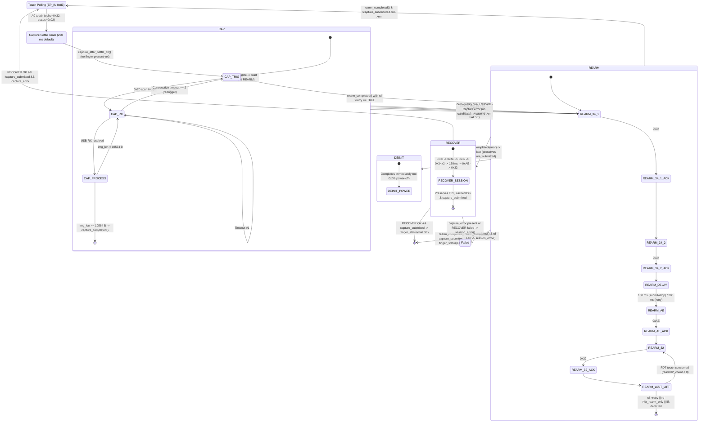

# State Machines and Transport Guarantees

All USB operations in `driver/goodix_gm168.c` execute asynchronously via `libfprint` `FpiSsm` sequential state machines on the GLib owner context. This document details every state machine, packet ACK rule, generation/cancellation guard, watchdog deadline, and recovery boundary.

## Overview of State Machines

| State Machine | Trigger | Deadline (`driver/gm168_timeouts.h`) | Completion Handler | Purpose |
|---|---|---|---|---|
| `INIT` (`init_run_state`) | `dev_activate()` slow path | `10000 ms` (`GM168_INIT_DEADLINE_MS`) | `init_completed()` | Wakeup, reset, version, pre-TLS PSK check/recovery, TLS handshake, register setup, 5-frame dark BG capture, initial FDT arm |
| `CAP` (`capture_run_state`) | `poll_cb()` touch + settle delay (or retry/dual #2) | `2000 ms` (`GM168_CAPTURE_DEADLINE_MS`) | `capture_completed()` | Scan trigger (`0x20`), budget-bounded `EP_IN` receive, `B0`/`B2` TLS decryption, quality gate, dual-capture orchestration, and early `gm168_submit_capture()` before `REARM` |
| `REARM` (`rearm_run_state`) | `capture_completed()` (after usable submit, zero-quality drop, retry, or capture error) | `6000 ms` (`GM168_REARM_DEADLINE_MS`) | `rearm_completed()` | Dual `0x34` discharge, settle delay, `0xAE` IRQ arm, `0x32` FDT setup, bounded `wait_lift` finger-release loop; clears `capture_submitted` and reports finger-off when submitted |
| `RECOVER` (`recover_run_state`) | `rearm_completed()` when `REARM` fails | `5000 ms` (`GM168_RECOVER_DEADLINE_MS`) | `recover_completed()` | Mid-session level-2 sensor recovery (`0x60` → `0xAE` → `0x32` → REARM chain) preserving active TLS, cached BG, and `capture_submitted` |
| `DEINIT` (`deinit_run_state`) | `dev_deactivate()` immediately, or `rearm_completed()` with `deinit_pending` | `3000 ms` (`GM168_DEINIT_DEADLINE_MS`) | `deinit_completed()` | Completes deactivation cleanly without issuing `0xD6` power-off so TLS state survives across enroll stages; active `REARM` drains first after client cancellation |

## `INIT` State Machine

```mermaid
stateDiagram-v2
    [*] --> INIT_WAKEUP : Slow path in dev_activate()
    INIT_WAKEUP --> INIT_WAKEUP_DELAY : 0x11 TX
    INIT_WAKEUP_DELAY --> INIT_RESET : 50 ms
    INIT_RESET --> INIT_RESET_ACK : 0x60 (01 00)
    INIT_RESET_ACK --> INIT_VERSION : ACK 00/01/03
    INIT_VERSION --> INIT_VERSION_ACK : 0x20 (empty)
    INIT_VERSION_ACK --> INIT_PSK_GATE : ACK 00/01/03

    INIT_PSK_GATE --> INIT_PSK_HASH_SEND : Both psk.bin & ENOENT paths

    INIT_PSK_HASH_SEND --> INIT_PSK_HASH_RECV : 0xE4 tag 0xbb020001 (32 B)
    INIT_PSK_HASH_RECV --> INIT_TLS_START : psk_loaded && hash match
    INIT_PSK_HASH_RECV --> INIT_PSK_READ_SEND : !psk_loaded && non-zero hash OK
    INIT_PSK_HASH_RECV --> Failed : mismatch / invalid / zero sentinel

    INIT_PSK_READ_SEND --> INIT_PSK_READ_RECV : 0xE4 tag 0xbb010002 (<=256 B)
    INIT_PSK_READ_RECV --> INIT_PSK_READ_SEND : NEED_MORE & reads < 16
    INIT_PSK_READ_RECV --> INIT_TLS_START : DPAPI+TLV valid & SHA256 match
    INIT_PSK_READ_RECV --> Failed : DPAPI/TLV/HMAC/IV/hash/budget error

    INIT_TLS_START --> INIT_TLS_START_ACK : 0xD0 (00 00)
    INIT_TLS_START_ACK --> INIT_TLS_RX
    INIT_TLS_RX --> INIT_TLS_DELAY : RX B0 fed to OpenSSL
    INIT_TLS_RX --> INIT_TLS_RX : RX timeout (!tls_done)
    INIT_TLS_DELAY --> INIT_TLS_TX_PULL : 10 ms
    INIT_TLS_TX_PULL --> INIT_TLS_TX_PULL : TX B0 flight (out_n > 0)
    INIT_TLS_TX_PULL --> INIT_TLS_RX : out_n == 0 && !tls_done
    INIT_TLS_TX_PULL --> INIT_SET_PARAM : tls_done == TRUE
    INIT_TLS_RX --> INIT_SET_PARAM : tls_done == TRUE
    INIT_TLS_RX --> Failed : tls_error from SSL_accept
    INIT_TLS_TX_PULL --> Failed : tls_error from SSL_accept

    INIT_SET_PARAM --> INIT_SET_PARAM_ACK : 0x90 (256 B)
    INIT_SET_PARAM_ACK --> INIT_DEL_TMPL_1
    INIT_DEL_TMPL_1 --> INIT_DEL_TMPL_1_ACK : 0xC4 (01 00)
    INIT_DEL_TMPL_1_ACK --> INIT_DEL_TMPL_2
    INIT_DEL_TMPL_2 --> INIT_DEL_TMPL_2_ACK : 0xC4 (01 00)
    INIT_DEL_TMPL_2_ACK --> INIT_SESSION
    INIT_SESSION --> INIT_SESSION_ACK : 0x60 (01 00)
    INIT_SESSION_ACK --> INIT_D6_POST
    INIT_D6_POST --> INIT_D6_POST_ACK : 0xD6 (00 00)
    INIT_D6_POST --> INIT_ARM : Skip 0xD6 if bg_retry_count > 0
    INIT_D6_POST_ACK --> INIT_ARM
    INIT_ARM --> INIT_ARM_ACK : 0xAE (00 01 00)
    INIT_ARM_ACK --> INIT_FDT
    INIT_FDT --> INIT_FDT_ACK : 0x32 (35 B)
    INIT_FDT_ACK --> INIT_BG_TRIG

    INIT_BG_TRIG --> INIT_BG_RX : 0x20 capture trigger
    INIT_BG_RX --> INIT_BG_PROCESS : any non-empty USB RX
    INIT_BG_RX --> INIT_BG_REARM_34_1 : non-timeout RX error (skip BG)
    INIT_BG_PROCESS --> INIT_BG_RX : img_len < 10564 B
    INIT_BG_PROCESS --> INIT_BG_LOOP_CHECK : decoded frame accumulated
    INIT_BG_LOOP_CHECK --> INIT_BG_TRIG : bg_frames_captured < 5
    INIT_BG_LOOP_CHECK --> INIT_BG_REARM_34_1 : 5 frames averaged & mean >= min_mean
    INIT_BG_LOOP_CHECK --> INIT_BG_REARM_34_1 : bg_mean < min_mean (sets bg_waiting_lift)

    INIT_BG_REARM_34_1 --> INIT_BG_REARM_34_2 : 0x34 + ACK (x2)
    INIT_BG_REARM_34_2 --> INIT_BG_REARM_DELAY : 150 ms
    INIT_BG_REARM_DELAY --> INIT_BG_REARM_AE : 0xAE + ACK
    INIT_BG_REARM_AE --> INIT_BG_REARM_32 : 0x32 + ACK
    INIT_BG_REARM_32 --> INIT_BG_WAIT_LIFT
    INIT_BG_WAIT_LIFT --> [*] : !bg_waiting_lift -> init_completed
    INIT_BG_WAIT_LIFT --> INIT_BG_REARM_32 : Quick-tap consumed (<= 8 rearms)
    INIT_BG_WAIT_LIFT --> INIT_SESSION : Finger lifted / cap -> retry BG
```



### Why PSK Recovery Lives Before TLS (and Why TLS Failure Never Triggers Recovery)

1. **Pre-TLS dependency**: `goodix_gm168_tls_init()` registers `psk_server_cb()` (`driver/goodix_tls.c`), which reads the 32-byte `goodix_gm168_psk` buffer as soon as the sensor sends its TLS `ClientHello` after `INIT_TLS_START` (`0xD0`). Both loading `psk.bin` and recovering from `0xE4` (`0xbb020001` + `0xbb010002`) therefore run in `INIT_PSK_GATE` **before** `0xD0` is ever sent.
2. **Pre-TLS cryptographic proof**: before `INIT_TLS_START` runs, the active key (whether loaded from `psk.bin` or recovered from `0xbb010002` + `0xbb010003`) has **already** matched the sensor's fresh `0xbb020001` SHA-256 reply in constant time (`CRYPTO_memcmp`).
3. **Why TLS failure never invokes recovery**: if `SSL_accept()` subsequently fails, the PSK is already known to match the MCU's `0xbb020001` digest. A failure at that stage indicates an OpenSSL provider/cipher-policy mismatch (e.g., missing `OPENSSL_CONF` for legacy `PSK-AES128-CBC-SHA256` on Fedora 45), a stale MCU TLS state from an unreset prior session, or USB framing loss—none of which can be fixed by re-reading `0xE4`. Falling back to recovery after TLS failure would also violate the fail-closed policy when an existing `psk.bin` mismatches.
4. **Handshake error propagation**: `on_tls_done()` stores the handshake `GError` in `self->tls_error` and cancels the current I/O wait. The INIT callbacks consume that saved error before their generic cancellation handling, so activation fails promptly with the TLS cause rather than the INIT watchdog. No PSK recovery is attempted.

## `CAP`, `REARM`, `RECOVER`, and `DEINIT` State Machines



### Key `CAP` / `REARM` / `RECOVER` Mechanics

- **Overlapped early submission (`gm168_submit_capture()`)**:
  - `capture_after_settle_cb()` does **not** call `fpi_image_device_report_finger_status(TRUE)` after the settle delay. The settle default was retuned `150 ms` → `220 ms` (`GM168_CAPTURE_SETTLE_MS`, provisional on one owner device, clamp `100..2000` via `$GM168_CAPTURE_SETTLE_MS`); `GM168_WAIT_LIFT_POLL_DEFAULT_MS = 150` is unchanged.
  - Once `capture_completed()` obtains a usable frame (`quality > 0.0f`), `gm168_submit_capture()` sets `self->capture_submitted = TRUE`, calls `report_finger_status(TRUE)` and `fpi_image_device_image_captured()`, and then launches `start_rearm_ssm()`.
  - Because `image_captured()` runs before `REARM`, `GTask` SIGFM extraction and verify/identify matching can complete concurrently while `REARM` runs the capacitive discharge (`0x34`) and `wait_lift` loop. Overlap responsiveness is independent of the provisional `150 ms` → `220 ms` settle retune documented above.
  - `dev_change_state(FPI_IMAGE_DEVICE_STATE_AWAIT_FINGER_OFF)` only clears `self->active_state = FALSE` and does **not** report finger-off (reporting it there would deactivate and cancel the active `REARM` SSM). Only `rearm_completed()` or `recover_completed()` clears `self->capture_submitted` and emits `report_finger_status(FALSE)`.
- **Zero-quality discard (no false-FDT retries)**:
  - If both dual frames have `quality == 0.0f` (or a mid-retry error fallback has `quality == 0.0f`), `capture_completed()` unrefs and discards the `FpImage`, keeps `self->capture_submitted == FALSE`, and runs `start_rearm_ssm(self, NULL)` without calling `report_finger_status(TRUE)`, `image_captured()`, or `retry_scan()`. No libfprint retry or verify attempt is consumed, and `rearm_completed()` resumes `start_polling()` since the core never left `AWAIT_FINGER_ON`.
  - Capture errors without a usable frame still pass `rd->err` through `REARM`/`RECOVER` and terminate with `fpi_image_device_session_error()`.
- **Quality/rank candidate selection (`driver/gm168_capture_policy.h`)**: best-of-N keep remains ordered by post-stretch `quality`, preserving the accept/retry invariant when a later frame crosses `GM168_QUALITY_THRESH`. Only the final dual success/error-fallback pick orders two usable frames by the pre-stretch raw rank (`gm168_raw_rank`, population variance of the background-subtracted central crop with a `> 30%` saturation rejection). `gm168_dual_pick()` checks post-quality for usability, then prefers the settled second frame unless the first clearly wins (`rank2 * 5 < rank1 * 4`); two usable zero ranks tie in favor of frame #2, while a rejected zero-quality frame cannot win. `gm168_effective_rank()` forces rank `0` whenever the post-stretch gate rejects a frame. The raw rank never drives the accept gate or zero-quality drop. While `dual_in_second` is set and frame #1 is usable (`dual_pending_quality > 0.0f`), `capture_completed()` accepts immediately after frame #2 instead of spending an extra rearm retry.
- **Budget-bounded `CAP_RX`**: each `CAP_RX` USB read uses `min(GM168_USB_RX_SHORT_TIMEOUT_MS, max(50, GM168_CAPTURE_BUDGET_MS - elapsed_ms))` (`1000 ms` max, `600 ms` total touch budget, `50 ms` floor) so a quiet sensor cannot stall past the budget.
- **Re-trigger on consecutive timeouts**: after `GM168_CAP_RX_RETRIG_AFTER` (`2`) consecutive `CAP_RX` timeouts, `capture_rx_cb()` jumps back to `CAP_TRIG` once in case the sensor dropped the scan trigger.
- **1-byte framing resync**: in `CAP_PROCESS`, encountering an unknown packet type byte drops **only 1 byte** from `self->stitch_buf` rather than wiping the whole buffer, preserving trailing valid packets.
- **TLS record drain and packet ownership**: after each `B0`/`B2` feed, `gm168_tls_drain()` reads the first record with the bounded socketpair wait and then drains all already-available records without sleeping. The consumed wire packet is removed from `stitch_buf` before `CAP` can complete, while any unprocessed tail remains buffered.
- **Background short-read progress**: every non-empty `INIT_BG_RX` transfer advances to `INIT_BG_PROCESS`; a residual wire tail smaller than `10564` bytes can therefore complete a partially decoded frame. A non-timeout USB error skips BG and enters the normal rearm chain instead of re-listening until the watchdog.
- **Recovery completion contract**: `REARM` and `RECOVER` no longer store an `FpImage` in `RearmData` or `RecoverData`; instead, `RECOVER` preserves `self->capture_submitted` (and any saved `rd->capture_error`) across escalation. If `RECOVER` fails, `recover_completed()` surfaces `fpi_image_device_session_error()` (superseding any older capture error). If `RECOVER` succeeds:
  - if `rd->capture_error` is present, it surfaces `fpi_image_device_session_error()`;
  - else if `self->capture_submitted` is `TRUE` (usable frame already submitted before `REARM`), it clears `capture_submitted` and reports `fpi_image_device_report_finger_status(img_dev, FALSE)`;
  - else (`!capture_submitted` and no `capture_error`, such as a discarded zero-quality touch or an unsubmitted retry), the core is still in `AWAIT_FINGER_ON`, so `recover_completed()` resumes `start_polling()` directly without emitting a libfprint retry.
- **Terminal USB/cancellation handling**: `FP_DEVICE_ERROR_REMOVED` bypasses fallback and recovery, and `G_IO_ERROR_CANCELLED` exits quietly without escalating to `RECOVER`. A recovery failure takes precedence over any older saved capture error.
- **Bounded `wait_lift_cb()`**: polls `EP_IN` with `gm168_wait_lift_poll_ms()` (`150 ms` default, configurable `50..1000 ms` via `$GM168_WAIT_LIFT_POLL_MS`).
  - If the finger stays on or quick-taps during `wait_lift`, FDT fires (`echo=0x32, status=0x02`) and sets `rd->consumed_touch = TRUE`. On the subsequent timeout, `wait_lift_cb()` jumps back to `REARM_32` to re-arm FDT (otherwise `start_polling()` would listen on a disarmed FDT).
  - Re-arms are capped at `GM168_WAIT_LIFT_MAX_REARMS` (`8`), after which `rd->fdt_rearm_only = TRUE` triggers one final `REARM_32` and exits `REARM_WAIT_LIFT` immediately.
  - `wait_lift_cb()` checks `gm168_ssm_deadline_expired()` **on every callback** (not only on state transitions) so continuous finger holding cannot loop indefinitely without hitting `GM168_REARM_DEADLINE_MS` (`6000 ms`).

## ACK Semantics (`0x00`, `0x01`, `0x03`) and Coalesced Packets

### Two `A0` Response Shapes

`ack_cb()` in `driver/goodix_gm168.c` handles both `A0` response layouts emitted by Goodix firmware:

1. **Inner-`0xB0`-marked ACK** (`packet_len >= 10 && packet[4] == GOODIX_GM168_PKT_TLS` (`0xB0`)):
   - `echo_cmd = packet[7]`, `status = packet[8]`.
   - Seen on `GFUSB` firmware (and as the immediate ACK preceding `0xE4` data responses).
2. **Direct-echo `A0` packet** decoded via `goodix_gm168_decode_ack()` (`driver/goodix_proto.c`):
   - `echo_cmd = packet[4]`, `status = packet[7]`, optional `extra = packet + 8` of length `inner_len - 5`.
   - Also carries `0x34` dark baseline readings (`gm168_calibrate_fdt()` extracts 6 channels from bytes `11..22` when `status == 0x00`) and `0x32` touch notifications (`status == 0x02`).

### Accepted ACK Status Codes

| Constant | Byte | Meaning | Behavior in `ack_cb()` |
|---|---:|---|---|
| `GOODIX_GM168_STATUS_OK` | `0x00` | Command succeeded | Advances SSM if `echo == expected_ack_cmd` |
| `GOODIX_GM168_STATUS_BUSY` | `0x01` | Immediate ACK / busy flag | Accepted by `ack_cb()`; in `0xE4` probes, `find_b0_ack()` triggers at most 1 continuation read |
| `GOODIX_GM168_STATUS_MORE` | `0x03` | `GFUSB` continuation flag (more response packets follow) | Accepted by `ack_cb()` and `find_b0_ack()` (`GFUSB_GM168SEC_APP_10036` emits `0x03` during init) |
| `GOODIX_GM168_STATUS_TOUCH` | `0x02` | Finger detected (on `echo=0x32`) | Ignored as command ACK in `ack_cb()`; triggers capture in `poll_cb()` |

Any other status byte fails the SSM immediately (`FP_DEVICE_ERROR_PROTO`).

### Coalesced Bulk Transfers & `0xE4` Single-Continuation Rule

- A single `16 KiB` `EP_IN` bulk transfer can contain multiple concatenated packets (`while (offset + 4 <= transfer->actual_length)`).
- `ack_cb()` walks every packet in the transfer:
  - Evaluates `0xA0` packets for `got_immediate` (ignoring `0x32`/`0x02` touch events and stale ACKs whose `echo` does not match `expected_ack_cmd`, in both ACK layouts).
  - Feeds any `0xB0`/`0xB2` packets in the same bulk transfer into `process_rx_buffer_for_tls()` so coalesced TLS handshake bytes are never dropped.
  - Advances only after inspecting the full transfer; if no matching ACK was seen, `ack_resubmit_or_fail()` re-submits up to `GM168_USB_RX_RETRY_LIMIT` (`60`).
- **Strict `0xE4` reply handling (`psk_hash_rx_cb`, `psk_read_rx_cb`)**:
  - First searches the entire coalesced transfer via `find_a0_ack()` for `echo == 0xE4`.
  - If absent, ONLY if `!deactivating && ack_retry == 0 && find_b0_ack(..., 0xE4)` detects an immediate `0x01`/`0x03` ACK, submits **one** continuation bulk read (`ack_retry = 1`).
  - Never re-sends `0xE4` and never loops past that single continuation read (`ack_resubmit_or_fail` is deliberately bypassed).

## Cancellation, Generation Guards, and Deadlines

### Generation & Cancellation Guards

- **Monotonic generation counter (`self->generation`)**:
  - Incremented at the start of `dev_activate()` and inside `gm168_dev_deactivate_now()`. A cancellation-deferred `dev_deactivate()` during active `REARM` deliberately preserves the current generation until `rearm_completed()`.
  - Every `FpiSsm` stores `generation` in `SsmData`; `RearmData` and `RecoverData` embed that header as their first `base` field, so `gm168_ssm_is_current()` accesses a real common subobject rather than aliasing unrelated struct types. `poll_cb()` and `capture_after_settle_cb()` receive `self->generation` via `user_data`.
  - `gm168_ssm_is_current()` and `gm168_ssm_callback_guard()` check `data->generation == self->generation` at the top of every `*_run_state` and USB callback; stale callbacks free any transfer error and fail with `G_IO_ERROR_CANCELLED`.
  - `gm168_activate_complete()` checks `self->activation_pending && generation == self->activation_generation` so deactivation mid-init cannot double-complete activation.
- **Shared `io_cancellable`**:
  - Created fresh in `dev_activate()`, wired to `fpi_device_get_cancellable()` via `action_cancelled_cb()`, and cancelled + unrefed in `gm168_dev_deactivate_now()`, aborting any pending `EP_IN`/`EP_OUT` transfer. The sole exception is `rearm_active && !device_dead`: both the callback and deferred deactivation preserve it until FDT restoration terminates.
- **USB Error Classification (`driver/gm168_usb_errors.h`)**:
  - `gm168_classify_usb_error()` categorizes `GError` into `OTHER`, `CANCELLED`, `TIMEOUT`, `NO_DEVICE`, and `IO`.
  - `gm168_handle_fatal_usb_error()` consumes `NO_DEVICE` across all SSM USB callbacks, sets `self->device_dead = TRUE`, and emits `FP_DEVICE_ERROR_REMOVED`. Action/transfer guards read `device_dead` to suppress new polling, commands, rearm, and recovery; a later activation cannot reuse the stale TLS fast path after removal.

### SIGFM Deferred Deactivation Barrier

The `FpImageDevice` core adds a lifecycle barrier around the existing GM168 USB state machines:

- A non-cancelling `fpi_image_device_deactivate()` call made while `finger_present` or `minutiae_scan_active` (including SIGFM extraction) is true sets `action_pending_deactivation` and returns without entering the driver's `DEINIT` SSM.
- The finger-off path and the extraction-completion callback retry the pending request. `DEINIT` starts only when both conditions are false, and the public action completes after normal deactivation completion.
- Final enrollment can therefore report its last stage without deactivating underneath an active frame callback; identify/verify can report a match during `REARM`/`wait_lift` while deferring `DEINIT` until finger-off and extraction completion.
- After `*_finish()`, a late extraction callback checks for a fatal `action_error`, `DEACTIVATING`, or `INACTIVE` before producing enroll progress or identify results. It completes the pending action instead, while `fp_image_device_enroll_maybe_await_finger_on()` additionally requires an active device in `IDLE`; a fatal `REARM`/`RECOVER` therefore cannot trigger an invalid `INACTIVE → AWAIT_FINGER_ON` transition or leave enrollment hanging.
- Cancellation uses `cancelling = TRUE` and clears the core pending flag. Outside active `REARM`, the driver immediately follows the normal generation/cancellation path. If `rearm_active && !device_dead`, `action_cancelled_cb()` preserves `io_cancellable`, and `dev_deactivate()` sets `deinit_pending` without incrementing generation or setting `self->deactivating`; `rearm_completed()` then runs `gm168_dev_deactivate_now()` on every success, error, or watchdog exit. This drains FDT restoration for the next fast path while remaining bounded by `GM168_REARM_DEADLINE_MS`. USB removal, capture, and `RECOVER` always cancel immediately.

Because the GM168 driver submits usable frames before `REARM`/`wait_lift`, the core barrier ensures a match or final enrollment result completed during `REARM` does not deactivate underneath that active SSM—teardown waits until `rearm_completed()` / `recover_completed()` emits `finger_status(FALSE)` and SIFT extraction is idle. It complements—but does not replace—`wait_lift_cb()`, `gm168_ssm_is_current()`, or `io_cancellable`. On `FPI_DEVICE_ACTION_IDENTIFY`, an empty (`NULL` or zero-length) gallery also short-circuits in `fp_image_device_start_capture_action()` with an immediate no-match report and completion without activating the sensor or invoking any SSM.

### Timing and Deadline Contract (`driver/gm168_timeouts.h`)

| Constant | Value | Role |
|---|---:|---|
| `GM168_USB_RX_TIMEOUT_MS` | `2000 ms` | Standard `EP_IN` ACK and `INIT_BG_RX` read timeout |
| `GM168_USB_RX_SHORT_TIMEOUT_MS` | `1000 ms` | `INIT_TLS_RX`, `CAP_RX` ceiling, polling, and `REARM` `0x34`/`0xAE` ACKs |
| `GM168_USB_RX_LONG_TIMEOUT_MS` | `3000 ms` | `INIT_FDT_ACK` (`0x32`) |
| `GM168_USB_TX_TIMEOUT_MS` | `2000 ms` | `EP_OUT` bulk transfer timeout |
| `GM168_WAKEUP_DELAY_MS` | `50 ms` | Post-`0x11` wakeup delay (no MCU ACK) |
| `GM168_TLS_PUMP_DELAY_MS` | `10 ms` | Pacing between `INIT_TLS_RX` and `INIT_TLS_TX_PULL` |
| `GM168_REARM_DELAY_MS` | `150 ms` | Capacitive front-end discharge delay between `0x34` and `0xAE` on submit |
| `GM168_REARM_RETRY_DELAY_MS` | `200 ms` | Delay during quality-gate capture retry (`driver/goodix_gm168.c`) |
| `GM168_CAPTURE_SETTLE_MS` | `220 ms` | Pre-capture finger settle delay (`$GM168_CAPTURE_SETTLE_MS`, `100..2000`; retuned `150` → `220` provisionally on one owner device) |
| `GM168_WAIT_LIFT_POLL_DEFAULT_MS` | `150 ms` | Default `wait_lift_cb` poll (`$GM168_WAIT_LIFT_POLL_MS`, `50..1000`; `gm168_timeouts.h` static assert uses `300 ms` worst-case bound) |
| `GM168_USB_RX_RETRY_LIMIT` | `60` | Per-state consecutive `ack_cb` / `bg_rx_cb` re-listen cap |
| `GM168_TLS_RETRY_LIMIT` | `60` | Max `INIT_TLS_RX` iterations |
| `GM168_WAIT_LIFT_MAX_REARMS` | `8` | Max `wait_lift_cb` → `REARM_32` loops before forced exit |
| `GM168_INIT_DEADLINE_MS` | `10000 ms` | Wall-clock deadline for `INIT` SSM |
| `GM168_CAPTURE_DEADLINE_MS` | `2000 ms` | Wall-clock deadline for `CAP` SSM (`> GM168_CAPTURE_BUDGET_MS` `600 ms`) |
| `GM168_REARM_DEADLINE_MS` | `6000 ms` | Wall-clock deadline for `REARM` SSM |
| `GM168_RECOVER_DEADLINE_MS` | `5000 ms` | Wall-clock deadline for `RECOVER` SSM |
| `GM168_DEINIT_DEADLINE_MS` | `3000 ms` | Wall-clock deadline for `DEINIT` SSM |

Compile-time `_Static_assert` checks in both `driver/gm168_timeouts.h` and `tests/test_timeouts.c` prevent silent drift across these invariants. The same standalone test executes the `gm168_lifecycle.h` predicate matrix for deferred `REARM` draining versus immediate cancellation.

## Fast Path Across Enroll Stages

`fprintd` cycles `dev_deactivate()` → `dev_activate()` between every enrollment stage (`20` stages for GM168) and across open/close bursts while the daemon stays resident:

- **Sensor behavior**: the MCU keeps its TLS session alive across `deactivate`/`activate`; sending a second `0xD0` (`TLS_START`) without a USB device reset leaves the MCU silent on `INIT_TLS_RX` until the watchdog trips.
- **Fast path condition** (`dev_activate()` in `driver/goodix_gm168.c`):
  ```c
  if (self->tls.ssl != NULL && self->tls_done && self->background != NULL)
  ```
  When true, `dev_activate()` skips USB reset, PSK loading/recovery, TLS handshake, `SET_PARAM`, and the 5-frame dark background capture, completing activation immediately (`gm168_activate_complete(self, self->generation, NULL)`).
- **Persistence across deactivate/close**: `dev_deactivate()` intentionally does **not** call `goodix_gm168_tls_cancel()`, and `dev_close()` keeps both the TLS session and USB interface claim alive until process exit or `fpi_device_goodix_gm168_finalize()`.
- **Slow path reset**: on cold start or error teardown, `dev_activate()` executes a USB `release_interface` → `reset` → `claim_interface` sequence so any stale TLS session from an earlier process is cleared before `INIT` runs.
