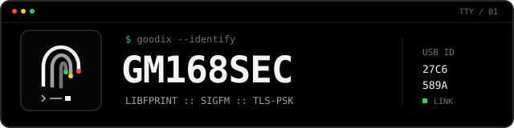

  

[English](../BRANDING.md) · **Русский** · [Проект](../../README.ru.md) · [Документация](README.md)

# Secure Signal — айдентика и система документации

Secure Signal — единый визуальный и редакторский язык `goodix-gm168sec`.
Он представляет проект как точную открытую инженерную разработку: честно
обозначает экспериментальный статус и границы безопасности и остаётся понятным
на английском и русском языках. Визуальная система **OLED CLI** использует
чистый чёрный цвет, белый моноширинный текст, спокойную серую структуру и редкие
светофорные акценты.

## 1. Принципы айдентики

- **Точность** — технические идентификаторы, версии и ограничения остаются видимыми.
- **Открытость** — нативный Markdown, локальные ресурсы, без трекинга и внешних изображений.
- **Внимание к безопасности** — формулировки о восстановлении и ограничениях должны оставаться точными.
- **Честность** — результаты синтетических тестов или проверки на ограниченном оборудовании не превращаются в общие утверждения.
- **Двуязычность** — оба языка принадлежат одному проекту, а не двум разным брендам.
- **Сначала монохром** — цвет обозначает отдельное состояние или сигнал, а не служит украшением.

## 2. Знак

Три монохромные синтетические сенсорные линии проходят через ёмкостное поле и
заканчиваются крошечными красными, янтарными и зелёными протокольными узлами.
Открытая геометрия обозначает доступную для исследования разработку, а узлы —
сигналы USB, TLS-PSK и сопоставления. Рисунок полностью построен из геометрических
примитивов и не содержит реальный отпечаток пальца. Небольшой prompt и блочный
курсор усиливают CLI-стилистику.

Словесный знак — **`GM168SEC`**. `GOODIX` обозначает семейство сенсоров;
`LIBFPRINT :: SIGFM :: TLS-PSK` — постоянный технический дескриптор. Название
`GM168SEC` не переводится.

## 3. Состав ресурсов

Все изображения локальны и автономны. SVG-файлы не содержат скриптов, удалённых
шрифтов, внешних изображений и сетевых зависимостей.

| Ресурс | Назначение |
|---|---|
| [`assets/brand/mark.svg`](../../assets/brand/mark.svg) | Компактный квадратный знак для документации и небольших ссылок на бренд |
| [`assets/brand/logo.svg`](../../assets/brand/logo.svg) | Горизонтальная композиция для руководств, презентаций и широких областей |
| [`assets/brand/header.svg`](../../assets/brand/header.svg) | Независимый от языка заголовок обеих корневых версий README |
| [`assets/brand/social-preview.svg`](../../assets/brand/social-preview.svg) | Редактируемый исходник social preview |
| [`assets/brand/social-preview.png`](../../assets/brand/social-preview.png) | Готовое изображение 1280×640 для настроек репозитория GitHub |

В документации используется SVG; PNG нужен только там, где требуется растровое
изображение. Сохраняйте исходные `viewBox` и пропорции.

## 4. Охранное поле и воспроизведение

- Оставляйте вокруг знака свободное пространство не менее четверти его ширины.
- Минимальный размер отдельного знака — **32 px**, горизонтального логотипа — **280 px**.
- Сохраняйте входящий в комплект чистый чёрный OLED-фон: он является частью конструкции логотипа.
- Не поворачивайте, не обрезайте, не обводите и не перекрашивайте логотип, не добавляйте градиенты, свечения и тени, не меняйте расположение элементов.
- Не размещайте знак поверх реальных отпечатков, дампов пакетов или пёстрых фотографий.
- Айдентика не должна намекать на одобрение Goodix, принятие в upstream, готовность к промышленному использованию или проведённый аудит безопасности.

## 5. Цветовая система

| Токен | Hex | Роль |
|---|---|---|
| **OLED Black** | `#000000` | Основной фон |
| **Terminal Black** | `#050505` | Поверхности знака и элементов управления |
| **Grid Gray** | `#2A2A2A` | Рамки, разделители и спокойная структура |
| **Muted Gray** | `#737373` | Третичные подписи и неактивные метаданные |
| **CLI Gray** | `#A3A3A3` | Вторичный текст и вторичные сенсорные линии |
| **Signal White** | `#F5F5F5` | Wordmark, основной текст и основные линии |
| **Stop Red** | `#FF453A` | Один небольшой протокольный узел или критическое состояние |
| **Wait Amber** | `#FFCC00` | Только предварительный статус и предупреждения |
| **Go Green** | `#30D158` | Один небольшой протокольный узел, prompt или активный статус |

Цвет используется как редкий сигнал: без градиентов, свечений, cyan-заливок и
разноцветного основного текста. Большая часть каждой композиции остаётся чёрной,
белой и серой. Основной текст, ссылки и код на GitHub используют нативные доступные
цвета платформы. Красный, янтарный и зелёный должны быть настолько небольшими,
чтобы монохромная структура оставалась доминирующей.

## 6. Типографика

- **Заголовки и wordmark:** JetBrains Mono с запасными DejaVu Sans Mono и monospace. Насыщенность 600; компактный трекинг допустим только в крупных размерах.
- **CLI-подписи и метаданные:** тот же моноширинный стек обычной насыщенности. Используется для prompt, USB ID, протокольных обозначений, версий и коротких статусных полей.
- **Текст на GitHub:** нативные sans-serif и monospace платформы. Обычный текст документации не следует превращать в изображения ради типографики.

Идентификаторы `27c6:589a`, `FPI_PRINT_SIGFM`, `psk.bin` и примеры команд
оформляются как inline code или блоки кода.

## 7. Композиция README

Корневая входная страница всегда следует одному порядку:

1. локальный hero `header.svg`;
2. взаимный переключатель **English / Русский**;
3. одно предложение с описанием проекта;
4. не более пяти важных бейджей: CI, лицензия, закреплённый libfprint, OpenSSL, статус;
5. основная навигация;
6. статус и ограничения перед инструкциями по сборке.

Hero, переключатель языка, бейджи, навигация и заголовки используют стандартное
выравнивание GitHub по левому краю. Не центрируйте эти элементы: общий левый
край сохраняет понятный порядок чтения слева направо и упрощает просмотр длинной
документации.

Не используются внешние анимированные надписи, повторяющиеся слоганы,
декоративные ряды бейджей и HTML-вёрстка длинного текста. Нативные заголовки,
таблицы, списки и блоки кода Markdown сохраняют предсказуемое отображение на
мобильных устройствах и доступность.

## 8. Двуязычная архитектура информации

- **Английский — канонический источник технического содержимого** на существующих путях. Это сохраняет установленные ссылки и рабочий процесс upstream.
- **Русские входные страницы отражают источник:** `README.ru.md`, `docs/ru/README.md` и `docs/ru/BRANDING.md`.
- В начале каждой переведённой страницы находится взаимный переключатель языка.
- На одной странице используется один язык. Полные английские и русские абзацы не чередуются внутри документа.
- Команды, код, идентификаторы, имена файлов и названия продуктов не изменяются.
- Пока подробное техническое руководство не переведено, русский индекс явно ссылается на английский источник вместо создания частичной или устаревшей копии.
- При изменении статуса, совместимости, ограничений, команд или правил безопасности обе входные страницы обновляются в рамках одного изменения.
- Переводы являются проверяемым содержимым проекта, а не машинным текстом, который может без контроля расходиться с источником.

## 9. Основная терминология

| English | Русский |
|---|---|
| developer preview | предварительная версия для разработчиков |
| driver overlay | оверлей драйвера |
| matching | сопоставление |
| enrollment | регистрация |
| verification | проверка |
| read-only in-memory PSK recovery | восстановление существующего PSK только в памяти без записи |
| synthetic fixture | синтетический тестовый набор |
| offline synthetic proof | подтверждение автономными синтетическими тестами |
| live hardware proof | подтверждение на реальном оборудовании |
| clean-room engineering | проектирование по принципу «чистой комнаты» |
| upstream-ready | готовый к включению в upstream |
| password fallback | резервная аутентификация по паролю |

Для операции matching используется **сопоставление**, а не **идентификация**,
если источник не описывает именно идентификацию. В кратких описаниях PSK recovery
всегда сохраняются условия **только для чтения** и **только в памяти**.

## 10. Тон и утверждения

Пишите прямо и раскрывайте необходимый жаргон. Вместо «безопасно» или «полностью
протестировано» лучше: «синтетический набор тестов проверяет этот парсер».
Всегда различайте:

- **подтверждение автономными синтетическими тестами** и **подтверждение на реальном оборудовании**;
- подтверждённую прошивку и возможную совместимость;
- разработку сообщества и поддержку upstream или производителя;
- восстановление только для чтения и provisioning или изменение ключа.

Реальные биометрические образцы, секреты, калибровочные данные и проприетарные
артефакты никогда не используются для рекламной графики.

## 11. GitHub Social Preview

GitHub не применяет social preview автоматически из файла в репозитории.
Загрузите [`assets/brand/social-preview.png`](../../assets/brand/social-preview.png)
вручную в **Repository → Settings → General → Social preview**. Сохраняйте SVG
как редактируемый источник и пересоздавайте PNG после утверждённых изменений айдентики.

## 12. Контрольный список для участников

Перед объединением изменений айдентики или входных страниц:

- проверьте каждый SVG как XML и визуально осмотрите результат рендеринга;
- проверьте читаемость в светлой и тёмной темах GitHub и на мобильной ширине;
- проверьте оба переключателя языка и каждую изменённую относительную ссылку;
- сравните статус, команды и предупреждения между EN и RU;
- убедитесь, что графика не содержит биометрических, секретных и проприетарных материалов;
- выполните `git diff --check` и просмотрите итоговый diff.
